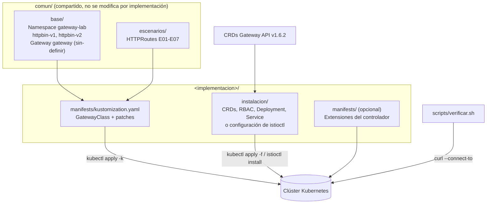
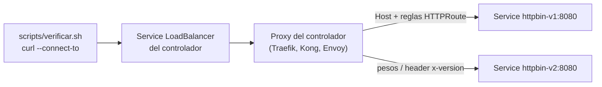

# gateway-api-lab

Laboratorio de referencia para implementar, probar y comparar controladores de
[Kubernetes Gateway API](https://gateway-api.sigs.k8s.io/) sobre un mismo
conjunto de manifiestos y pruebas. Cada implementación (Istio, Cilium, Kong y
Traefik) se instala sin Helm, se conecta a una base común mediante un overlay de
Kustomize y se valida con los mismos siete escenarios automatizados.

| Elemento | Valor |
|---|---|
| Especificación | Gateway API v1.6.2, canal Standard |
| Kubernetes mínimo | 1.31 (validación CEL de `TLSRoute` desde Gateway API v1.5) |
| Clúster de referencia | minikube con driver Docker |
| Backend de pruebas | `mccutchen/go-httpbin:2.25.0`, versiones `v1` y `v2` |
| Escenarios comunes | E01-E07 (`comun/escenarios/`) |
| Instalación de controladores | Manifiestos versionados o instalador propio del proveedor; sin Helm |
| Validación CI | GitHub Actions: kustomize, kubeconform y shellcheck |

## Contenido

1. [Contexto: de Ingress a Gateway API](#1-contexto-de-ingress-a-gateway-api)
2. [Arquitectura del laboratorio](#2-arquitectura-del-laboratorio)
3. [Estructura del repositorio](#3-estructura-del-repositorio)
4. [Base común](#4-base-común)
5. [Escenarios E01-E07](#5-escenarios-e01-e07)
6. [Scripts](#6-scripts)
7. [Implementaciones](#7-implementaciones)
8. [Comparativa de resultados](#8-comparativa-de-resultados)
9. [Componentes y herramientas utilizados](#9-componentes-y-herramientas-utilizados)
10. [Guía de uso](#10-guía-de-uso)
11. [Validación continua](#11-validación-continua)
12. [Flujo de trabajo](#12-flujo-de-trabajo)
13. [Troubleshooting general](#13-troubleshooting-general)
14. [Limpieza](#14-limpieza)
15. [Equipos](#15-equipos)
16. [Referencias](#16-referencias)

## 1. Contexto: de Ingress a Gateway API

### Ingress

`Ingress` (`networking.k8s.io/v1`) es el recurso original de Kubernetes para
exponer Services HTTP/HTTPS fuera del clúster. Define reglas de host y path
hacia un Service; un Ingress Controller las ejecuta.

Limitaciones:

- Soporte nativo solo para HTTP y HTTPS.
- Funcionalidad avanzada (rewrites, canary, rate limiting) dependiente de
  annotations propias de cada controlador, lo que impide la portabilidad.
- Un único objeto mezcla configuración de infraestructura (puertos, TLS) y de
  aplicación (rutas).
- Annotations sin validación de esquema.
- Fragmentación: cada proveedor definió CRDs propios (`IngressRoute` en Traefik,
  `TCPIngress` en Kong, `VirtualService` en Istio).

La API de Ingress está congelada: se mantiene, pero no recibe nuevas
funcionalidades. El controlador `ingress-nginx` fue retirado en marzo de 2026.

### Gateway API

Gateway API es el sucesor de Ingress, mantenido por SIG-Network. Es un conjunto
de CRDs (`gateway.networking.k8s.io`), GA desde v1.0 (octubre de 2023), con
v1.6.2 como versión estable actual.

- Modelo orientado a roles: cada recurso corresponde a un responsable distinto.
- Portabilidad entre implementaciones, verificada con pruebas de conformidad.
- Soporte para HTTP, HTTPS, gRPC, TLS, TCP y UDP.
- Matching por path, headers, query params y método; pesos de tráfico y
  filtros tipados en la especificación.
- Puntos de extensión definidos: `parametersRef`, filtros `ExtensionRef` y
  policies con `targetRefs`.

```text
Proveedor de infraestructura   Operador del clúster      Desarrollador
            |                          |                       |
       GatewayClass  -------------> Gateway  -------------> xRoute  -----> Service
   (controlador)             (listeners, TLS)         (reglas de enrutamiento)
```

| Recurso | Responsable | Función |
|---|---|---|
| `GatewayClass` | Proveedor de infraestructura | Declara el controlador que implementa los Gateways. |
| `Gateway` | Operador del clúster | Define listeners: puertos, protocolos, hostnames y TLS. |
| `HTTPRoute`, `GRPCRoute`, `TLSRoute`, ... | Desarrollador de la aplicación | Define el enrutamiento hacia los Services. |
| `ReferenceGrant` | Dueño del namespace destino | Autoriza referencias entre namespaces. |

| Criterio | Ingress | Gateway API |
|---|---|---|
| Protocolos | HTTP, HTTPS | HTTP, HTTPS, gRPC, TLS, TCP, UDP |
| Separación de roles | No | Sí |
| Configuración avanzada | Annotations propietarias | Campos tipados de la especificación |
| Portabilidad | Baja | Alta (conformidad) |
| Referencias entre namespaces | No | Sí (`ReferenceGrant`) |
| Estado | Congelada | En desarrollo activo |

Detalle en:

- [`docs/01-de-ingress-a-gateway-api.md`](docs/01-de-ingress-a-gateway-api.md):
  limitaciones de Ingress y equivalencias.
- [`docs/02-recursos-de-gateway-api.md`](docs/02-recursos-de-gateway-api.md):
  GatewayClass, Gateway, HTTPRoute, filtros, otros tipos de ruta,
  `ReferenceGrant`, `ListenerSet`, condiciones de estado y canales.

## 2. Arquitectura del laboratorio

El diseño separa lo que es igual para todos los controladores (backends,
Gateway, rutas y pruebas) de lo que depende de cada uno (instalación,
GatewayClass y ajustes del overlay).



Flujo de una petición durante las pruebas:



1. El script resuelve la dirección del Gateway desde `status.addresses` y envía
   la petición con `curl --connect-to`, sin depender de DNS ni `/etc/hosts`.
2. El Service del controlador recibe el tráfico en 80/443 (o en los puertos de
   `port-forward`/NodePort).
3. El proxy selecciona listener y virtual host por el header `Host`
   (`<escenario>.lab.local`) y aplica matches, filtros y pesos de la HTTPRoute.
4. La petición llega a `httpbin-v1` o `httpbin-v2`; el endpoint `/hostname`
   devuelve el nombre del pod y permite identificar qué versión respondió.

## 3. Estructura del repositorio

```text
.
├── README.md                          Este documento
├── CONTRIBUTING.md                    Ramas, commits, Pull Requests, estilo y restricciones
├── LICENSE
├── .gitignore                         Excluye kubeconfigs, claves, certificados y temporales
├── .github/
│   ├── CODEOWNERS                     Revisión obligatoria de @Melo088
│   ├── PULL_REQUEST_TEMPLATE.md       Alcance y checklist del Pull Request
│   └── workflows/validar.yaml         CI: kustomize + kubeconform + shellcheck
├── docs/
│   ├── 01-de-ingress-a-gateway-api.md Conceptos y comparación
│   ├── 02-recursos-de-gateway-api.md  Recursos, filtros, estado y canales
│   ├── 03-levantar-el-entorno.md      Clúster (minikube, kind, k3d, gestionado) y CRDs
│   └── 04-escenarios.md               Convenciones, escenarios, acceso y limpieza
├── comun/
│   ├── kustomization.yaml             Une base/ y escenarios/
│   ├── base/
│   │   ├── namespace.yaml             Namespace gateway-lab
│   │   ├── httpbin.yaml               Deployments y Services httpbin-v1 / httpbin-v2
│   │   ├── gateway.yaml               Gateway con listeners http (80) y https (443)
│   │   └── kustomization.yaml         Namespace y label app.kubernetes.io/part-of
│   └── escenarios/
│       ├── 01-enrutamiento.yaml       E01
│       ├── 02-match-header.yaml       E02
│       ├── 03-pesos.yaml              E03
│       ├── 04-modificar-headers.yaml  E04
│       ├── 05-rewrite.yaml            E05
│       ├── 06-redirect.yaml           E06
│       ├── 07-tls.yaml                E07
│       └── kustomization.yaml
├── scripts/
│   ├── crear-certificado.sh           Certificado autofirmado *.lab.local y Secret gateway-tls
│   └── verificar.sh                   Pruebas automatizadas E01-E07
├── plantillas/
│   ├── PLANTILLA-implementacion.md    Estructura obligatoria del README de cada implementación
│   └── kustomization.yaml             Overlay base para una implementación
├── istio/                             Implementación Istio (istioctl, perfil ambient)
├── kong/                              Implementación Kong (KIC + Kong Gateway DB-less)
├── traefik/                           Implementación Traefik (proveedor kubernetesgateway)
└── cilium/                            Implementación Cilium (cilium-cli, eBPF, sin kube-proxy)
```

Cada carpeta de implementación sigue la misma estructura:

```text
<implementacion>/
├── README.md          Documentación según plantillas/PLANTILLA-implementacion.md
├── instalacion/       Manifiestos o configuración del instalador propio del controlador (sin Helm)
├── manifests/         Overlay kustomize sobre comun/ y recursos propios del controlador
└── evidencias/        Capturas, salidas de comandos y diagramas
```

## 4. Base común

Los manifiestos de [`comun/`](comun) son idénticos para todas las
implementaciones. Ninguna implementación los modifica; cada overlay solo define
la GatewayClass y los ajustes que exija su controlador.

### 4.1 Convenciones

| Elemento | Valor |
|---|---|
| Namespace | `gateway-lab` |
| Label común | `app.kubernetes.io/part-of: gateway-api-lab` |
| Gateway | `gateway`, `gatewayClassName: sin-definir` (se reemplaza en el overlay) |
| Listener `http` | puerto 80, protocolo HTTP, hostname `*.lab.local`, rutas del mismo namespace |
| Listener `https` | puerto 443, protocolo HTTPS, `tls.mode: Terminate`, Secret `gateway-tls` |
| Backends | Services `httpbin-v1` y `httpbin-v2`, puerto 8080 |
| HTTPRoutes | `eNN-<escenario>`, un hostname por escenario |

Cada escenario usa un hostname propio, por lo que todos coexisten en el mismo
Gateway sin interferencias.

### 4.2 Backend httpbin

[`comun/base/httpbin.yaml`](comun/base/httpbin.yaml) despliega dos versiones del
mismo servicio para los escenarios de matching y pesos:

| Recurso | Labels | Detalle |
|---|---|---|
| Deployment `httpbin-v1` / `httpbin-v2` | `app: httpbin`, `version: v1` / `v2` | Imagen `mccutchen/go-httpbin:2.25.0`, 1 réplica, puerto 8080. |
| Variable `USE_REAL_HOSTNAME=true` | | `/hostname` devuelve el nombre real del pod, lo que identifica la versión. |
| Readiness probe | | `GET /status/200` sobre el puerto `http`. |
| Recursos | | Requests `10m` CPU y `16Mi` memoria; límite `64Mi`. |
| Service `httpbin-v1` / `httpbin-v2` | | ClusterIP, puerto 8080 hacia `targetPort: http`. |

Endpoints de httpbin usados por las pruebas: `/get`, `/hostname`, `/headers`,
`/status/<codigo>` y `/anything/<ruta>`.

### 4.3 Gateway

[`comun/base/gateway.yaml`](comun/base/gateway.yaml):

```yaml
apiVersion: gateway.networking.k8s.io/v1
kind: Gateway
metadata:
  name: gateway
spec:
  gatewayClassName: sin-definir
  listeners:
    - name: http
      protocol: HTTP
      port: 80
      hostname: "*.lab.local"
      allowedRoutes:
        namespaces:
          from: Same
    - name: https
      protocol: HTTPS
      port: 443
      hostname: "*.lab.local"
      tls:
        mode: Terminate
        certificateRefs:
          - kind: Secret
            name: gateway-tls
      allowedRoutes:
        namespaces:
          from: Same
```

El listener `https` requiere el Secret `gateway-tls`, creado por
[`scripts/crear-certificado.sh`](scripts/crear-certificado.sh).

### 4.4 Overlay de una implementación

[`plantillas/kustomization.yaml`](plantillas/kustomization.yaml) es el punto de
partida de `<implementacion>/manifests/kustomization.yaml`:

```yaml
apiVersion: kustomize.config.k8s.io/v1beta1
kind: Kustomization
resources:
  - ../../comun
  # - gatewayclass.yaml        # si el controlador no crea su GatewayClass
patches:
  - target:
      kind: Gateway
      name: gateway
    patch: |-
      - op: replace
        path: /spec/gatewayClassName
        value: <gatewayclass>
  # Solo si el controlador exige puertos de listener distintos a 80/443:
  # - op: replace
  #   path: /spec/listeners/0/port
  #   value: 8000
```

## 5. Escenarios E01-E07

Definidos en [`comun/escenarios/`](comun/escenarios) y descritos en
[`docs/04-escenarios.md`](docs/04-escenarios.md). El nivel de soporte
corresponde a la especificación de Gateway API: una funcionalidad Extended
puede no estar implementada; en ese caso se documenta el resultado y, si
existe, la alternativa propia del controlador.

| ID | Manifiesto | Hostname | Funcionalidad | Soporte | Prueba | Resultado esperado |
|---|---|---|---|---|---|---|
| E01 | [`01-enrutamiento.yaml`](comun/escenarios/01-enrutamiento.yaml) | `enrutamiento.lab.local` | Enrutamiento por hostname y `PathPrefix /` | Core | `GET /get` | 200 |
| E02 | [`02-match-header.yaml`](comun/escenarios/02-match-header.yaml) | `match.lab.local` | Matching `Exact` por header `x-version: v2` | Core | `GET /hostname` con y sin header | `httpbin-v2` con header, `httpbin-v1` sin header |
| E03 | [`03-pesos.yaml`](comun/escenarios/03-pesos.yaml) | `pesos.lab.local` | `backendRefs` con pesos 80/20 | Core | 100 x `GET /hostname` | Entre 8 y 35 respuestas de `httpbin-v2` |
| E04 | [`04-modificar-headers.yaml`](comun/escenarios/04-modificar-headers.yaml) | `headers.lab.local` | `RequestHeaderModifier` y `ResponseHeaderModifier` (`x-gateway-lab`) | Core, Extended | `GET /headers` | `x-gateway-lab: request` en la petición y `x-gateway-lab: response` en la respuesta |
| E05 | [`05-rewrite.yaml`](comun/escenarios/05-rewrite.yaml) | `rewrite.lab.local` | `URLRewrite` `ReplacePrefixMatch` `/api` a `/` | Extended | `GET /api/status/200` | 200 |
| E06 | [`06-redirect.yaml`](comun/escenarios/06-redirect.yaml) | `redirect.lab.local` | `RequestRedirect` `scheme: https`, `statusCode: 301` | Core | `GET http://.../get` | 301, `Location: https://redirect.lab.local/...` |
| E07 | [`07-tls.yaml`](comun/escenarios/07-tls.yaml) | `tls.lab.local`, `redirect.lab.local` | Terminación TLS en el listener `https` | Core | `GET https://.../get` | 200 |

Notas de diseño:

- Todas las rutas declaran `sectionName` para adjuntarse a un listener
  concreto: E01-E06 al listener `http`, E07 al listener `https`.
- E07 también atiende `redirect.lab.local`, destino de la redirección de E06.
- En E02 la regla con match de header se declara primero; la regla sin
  `matches` actúa como ruta por defecto hacia `httpbin-v1`.

## 6. Scripts

Los scripts requieren `bash`, `kubectl`, `curl` y `openssl`. En Windows se
ejecutan desde WSL o Git Bash.

### 6.1 `scripts/crear-certificado.sh`

Genera con `openssl` un certificado autofirmado RSA 2048, válido 365 días, para
`*.lab.local` (SAN `*.lab.local` y `lab.local`), crea el namespace si no existe
y aplica el Secret TLS de forma idempotente (`--dry-run=client -o yaml | kubectl
apply -f -`). La clave se genera en un directorio temporal que se borra al
terminar; nunca queda en el repositorio.

| Variable | Valor por defecto | Uso |
|---|---|---|
| `NAMESPACE` | `gateway-lab` | Namespace del Gateway |
| `SECRET` | `gateway-tls` | Nombre del Secret |
| `DOMINIO` | `lab.local` | Dominio base del certificado |

### 6.2 `scripts/verificar.sh`

Ejecuta las pruebas de E01-E07 contra el Gateway y reporta `PASS` o `FAIL` por
escenario. Termina con código 0 si no hay fallos y 1 en caso contrario; con
código 2 si no puede determinar la dirección del Gateway.

| Variable | Valor por defecto | Uso |
|---|---|---|
| `NAMESPACE` | `gateway-lab` | Namespace del Gateway |
| `GATEWAY` | `gateway` | Nombre del Gateway |
| `GATEWAY_ADDRESS` | `status.addresses[0].value` del Gateway | IP o hostname de destino |
| `HTTP_PORT` | `80` | Puerto real del listener `http` |
| `HTTPS_PORT` | `443` | Puerto real del listener `https` |
| `DOMINIO` | `lab.local` | Dominio base de los hostnames |

Funcionamiento:

- Cada petición usa `curl -sk -i --max-time 5 --connect-to
  <host>:<puerto-url>:<GATEWAY_ADDRESS>:<puerto>`, de modo que el header `Host`
  y el SNI son los del escenario aunque la conexión vaya a otra dirección o
  puerto.
- E03 envía 100 peticiones y acepta entre 8 y 35 respuestas de `httpbin-v2`,
  margen para la variación estadística del 20 %.
- E04 comprueba el header en el cuerpo devuelto por `/headers` (petición) y en
  los headers de la respuesta.

Salida esperada:

```text
Gateway: gateway-lab/gateway  Dirección: 10.108.164.101  HTTP: 80  HTTPS: 443

PASS  E01  Enrutamiento por hostname y path
PASS  E02  Matching por header x-version
PASS  E03  Pesos 80/20 (20/100 hacia v2)
PASS  E04  Modificación de headers de petición y respuesta
PASS  E05  Rewrite /api/<ruta> hacia /<ruta>
PASS  E06  Redirección HTTP a HTTPS (301)
PASS  E07  Terminación TLS

Fallos: 0/7
```

## 7. Implementaciones

| Implementación | Estado | Tipo de componente | Versión | Instalación | GatewayClass | Ajustes del overlay | Escenarios |
|---|---|---|---|---|---|---|---|
| [Traefik](traefik/README.md) | Integrada | Reverse proxy / API gateway | Traefik v3.7.14 | `kubectl apply -f traefik/instalacion/` | `traefik` (declarada en el overlay) | Puertos de listener 8000/8443 | 7/7 |
| [Kong](kong/README.md) | Integrada | API gateway | KIC 3.5.0 + Kong Gateway 3.8.0 (DB-less) | `kubectl apply --server-side=true -f kong/instalacion/` | `kong` (declarada en el overlay, unmanaged) | Anotación `konghq.com/publish-service` | 6/7 (E06 falla) |
| [Istio](istio/README.md) | Integrada | Service mesh | Istio 1.31.2, perfil `ambient` | `istioctl install -f istio/instalacion/istio.yaml` | `istio` (creada por istiod) | Solo `gatewayClassName` | 7/7 + 5/5 extensiones |
| [Cilium](cilium/README.md) | Integrada | CNI con eBPF + Envoy | Cilium 1.20.3 | `cilium install --version 1.20.3 -f cilium/instalacion/cilium.yaml` | `cilium` (creada por cilium-operator) | Solo `gatewayClassName` | 7/7 + 2/2 extensión L7 |

### 7.1 Traefik

Documentación completa: [`traefik/README.md`](traefik/README.md) y bitácora paso
a paso en [`traefik/instalacion/instalación.md`](traefik/instalacion/instalación.md).

Traefik es un proxy inverso y API gateway de código abierto mantenido por
Traefik Labs. El mismo proceso actúa como plano de control (proveedor
`kubernetesgateway`, que observa GatewayClass, Gateway y HTTPRoute) y como
plano de datos (entrypoints que reciben el tráfico).

| Archivo | Contenido |
|---|---|
| [`instalacion/01-namespace.yaml`](traefik/instalacion/01-namespace.yaml) | Namespace `traefik`. |
| [`instalacion/02-rbac.yaml`](traefik/instalacion/02-rbac.yaml) | ServiceAccount, ClusterRole (lectura de Services, Secrets, EndpointSlices y recursos de Gateway API; escritura de `status`) y ClusterRoleBinding. |
| [`instalacion/03-deployment.yaml`](traefik/instalacion/03-deployment.yaml) | Imagen `docker.io/traefik:v3.7.14`, usuario no root (65532), sistema de archivos de solo lectura. |
| [`instalacion/04-service.yaml`](traefik/instalacion/04-service.yaml) | Service `LoadBalancer` 80/443 hacia 8000/8443. |
| [`manifests/gatewayclass.yaml`](traefik/manifests/gatewayclass.yaml) | GatewayClass `traefik`, `controllerName: traefik.io/gateway-controller`. |
| [`manifests/kustomization.yaml`](traefik/manifests/kustomization.yaml) | `gatewayClassName: traefik` y puertos de listener 8000 y 8443. |

Configuración estática relevante del Deployment:

| Argumento | Función |
|---|---|
| `--entryPoints.web.address=:8000/tcp` | Entrypoint HTTP. |
| `--entryPoints.websecure.address=:8443/tcp`, `--entryPoints.websecure.http.tls=true` | Entrypoint HTTPS con terminación TLS. |
| `--entryPoints.traefik.address=:8080/tcp`, `--ping=true` | Endpoint `/ping` para las probes. |
| `--providers.kubernetesgateway` | Habilita el soporte de Gateway API. |
| `--providers.kubernetesgateway.statusaddress.service.name` / `.namespace` | Publica la dirección del Service en `status.addresses` del Gateway. |

Comportamiento específico:

- Traefik solo acepta un listener cuyo puerto coincida con un entrypoint del
  pod. Con los puertos 80/443 de `comun/` el Gateway se rechaza con `no
  matching entryPoint for port 80`; por eso el overlay los cambia a 8000/8443.
  El Service sigue exponiendo 80/443 hacia fuera.
- No requiere CRDs propios (`IngressRoute`, `Middleware`): todos los escenarios
  se resuelven con recursos estándar.

Resultado: 7/7 escenarios en `PASS` sobre minikube v1.39.0 / Kubernetes v1.37.0,
y verificado también en clúster limpio con minikube v1.38.1 / Kubernetes
v1.35.1. Evidencias en [`traefik/evidencias/`](traefik/evidencias).

### 7.2 Kong

Documentación completa: [`kong/README.md`](kong/README.md).

Kong Gateway es un API gateway basado en OpenResty/Nginx. En Kubernetes se
opera con Kong Ingress Controller (KIC), que traduce Gateway API a entidades de
Kong y las carga en memoria del proxy en modo DB-less. Se usa el modelo de
Gateway no gestionado (unmanaged), con KIC y el proxy en el mismo pod.

| Componente | Imagen | Función |
|---|---|---|
| Contenedor `ingress-controller` (KIC) | `kong/kubernetes-ingress-controller:3.5.0` | Plano de control. Observa Gateway API y CRDs de Kong; envía la configuración a la Admin API local (`https://localhost:8444`). |
| Contenedor `proxy` (Kong Gateway) | `kong:3.8.0` | Plano de datos DB-less. Escucha en 8000 (HTTP) y 8443 (HTTPS). |

| Archivo | Contenido |
|---|---|
| [`instalacion/00-namespace.yaml`](kong/instalacion/00-namespace.yaml) | Namespace `kong`. |
| [`instalacion/01-crds.yaml`](kong/instalacion/01-crds.yaml) | CRDs de Kong (`configuration.konghq.com`): `KongPlugin`, `KongClusterPlugin`, `KongConsumer`, `KongIngress`, `TCPIngress`, `UDPIngress`, entre otros. |
| [`instalacion/02-rbac.yaml`](kong/instalacion/02-rbac.yaml) | ServiceAccount, ClusterRole/ClusterRoleBinding y Role/RoleBinding para elección de líder (`leases`) y eventos. |
| [`instalacion/03-service.yaml`](kong/instalacion/03-service.yaml) | Service `kong-proxy` `LoadBalancer` 80/443 hacia 8000/8443, con `targetPort` numérico. |
| [`instalacion/04-deployment.yaml`](kong/instalacion/04-deployment.yaml) | Pod con KIC y proxy; sin webhook de admisión. |
| [`manifests/gatewayclass.yaml`](kong/manifests/gatewayclass.yaml) | GatewayClass `kong`, `controllerName: konghq.com/kic-gateway-controller`, anotación `konghq.com/gatewayclass-unmanaged: "true"`. |
| [`manifests/kustomization.yaml`](kong/manifests/kustomization.yaml) | `gatewayClassName: kong` y anotación `konghq.com/publish-service: kong/kong-proxy` en el Gateway. |
| [`manifests/extension-ratelimit.yaml`](kong/manifests/extension-ratelimit.yaml) | Extensión: `KongPlugin` `rate-limiting` (5 peticiones por minuto) asociado a la HTTPRoute `e08-extension-ratelimit` (`ratelimit.lab.local`) mediante `ExtensionRef`. Se aplica aparte con `kubectl apply -f`. |

Comportamiento específico:

- El `targetPort` del Service debe ser numérico: KIC lo compara con
  `KONG_PROXY_LISTEN` para aceptar los listeners; con nombre de puerto quedan en
  `UnsupportedProtocol`.
- Las versiones están fijadas a Kong 3.8.0 y KIC 3.5.0: Kong 3.9 o superior
  rechaza los certificados traducidos por KIC (`value must be null`).
- E06 falla. KIC no aísla rutas por listener (`sectionName`): crea las rutas de
  E06 y E07 con `protocols: [http, https]` para el mismo host, y la petición
  HTTP la atiende la de E07 (200). Además traduce `RequestRedirect` a
  `request-termination` (301) con `Location: /` fijo, sin esquema ni host. La
  alternativa nativa es `konghq.com/protocols: "https"` con
  `konghq.com/https-redirect-status-code: "301"`.

Resultado: 6/7 escenarios en `PASS` (E06 en `FAIL`); la extensión de rate
limiting devuelve `429 Too Many Requests` en la sexta petición del minuto.
Evidencias en [`kong/evidencias/`](kong/evidencias).

### 7.3 Istio

Documentación completa: [`istio/README.md`](istio/README.md).

Istio es un service mesh graduado de la CNCF, con Envoy como plano de datos (y
ztunnel en modo ambient). Gateway API es su API recomendada tanto para tráfico
de entrada (norte-sur) como interno del mesh (este-oeste, iniciativa GAMMA).

| Plano | Componente | Función |
|---|---|---|
| Control | `istiod` (`istio-system`) | Traduce Gateway API a configuración de Envoy (xDS), emite certificados mTLS y crea el Deployment y Service de cada Gateway. |
| Datos | `gateway-istio` (`gateway-lab`) | Envoy creado a partir del Gateway `gateway`; termina TLS y aplica HTTPRoutes y políticas. |
| Datos | `ztunnel` (DaemonSet) | Proxy L4 por nodo del modo ambient; mTLS HBONE (puerto 15008). |
| Datos | `istio-cni` (DaemonSet) | Redirige el tráfico de los pods ambient hacia ztunnel. |
| Datos | `waypoint` (`gateway-lab`) | Envoy L7 del mesh para la extensión X03 (clase `istio-waypoint`). |

| Archivo | Contenido |
|---|---|
| [`instalacion/istio.yaml`](istio/instalacion/istio.yaml) | `IstioOperator` para `istioctl`: `profile: ambient`, `tag: 1.31.2`, `global.platform: minikube` (necesario para istio-cni en minikube con driver docker). No se aplica al clúster; `istioctl` lo lee y genera los manifiestos. |
| [`manifests/kustomization.yaml`](istio/manifests/kustomization.yaml) | Solo reemplaza `gatewayClassName: istio`. |
| [`manifests/extensiones/`](istio/manifests/extensiones) | Extensiones X01-X03, su kustomization y su script `verificar.sh`. |

GatewayClass creadas por istiod: `istio` (entrada, usada en E01-E07, X01, X02),
`istio-waypoint` (mesh, usada en X03) e `istio-remote` (multi-clúster, no se
usa).

Extensiones fuera de Gateway API:

| ID | Recursos | Prueba |
|---|---|---|
| X01 | HTTPRoute `authz.lab.local`, `AuthorizationPolicy` DENY con `targetRefs` al Gateway | `/anything/publico` 200, `/anything/privado` 403 |
| X02 | HTTPRoute `jwt.lab.local`, `RequestAuthentication` con JWKS inline, `AuthorizationPolicy` DENY | Sin token 403, token inválido 401, token válido 200 y claim `sub` en `x-jwt-sub` |
| X03 | Namespace en ambient, `PeerAuthentication` STRICT, Gateway `waypoint`, HTTPRoute GAMMA con `parentRef` al Service `httpbin-v1`, pods `cliente` | Reparto 50/50 desde el mesh; cliente de `fuera-mesh` rechazado |

Comportamiento específico:

- No requiere parche de puertos: Istio agrega al pod el sysctl
  `net.ipv4.ip_unprivileged_port_start=0` y Envoy abre 80/443 como no root.
- Un Deployment de Envoy por Gateway (`<gateway>-<gatewayclass>`), con
  `ownerReference` al Gateway.
- El Gateway queda `Programmed=False` (`AddressNotAssigned`) mientras el Service
  `LoadBalancer` no tiene dirección; el tráfico se procesa igual. Las evidencias
  usan acceso por NodePort.

Resultado: 7/7 escenarios en `PASS` (también con las extensiones aplicadas) y
5/5 pruebas de extensiones. Evidencias en [`istio/evidencias/`](istio/evidencias).

### 7.4 Cilium

Documentación completa: [`cilium/README.md`](cilium/README.md).

Cilium es un CNI basado en eBPF, graduado de la CNCF. Reemplaza a `kube-proxy` y
actúa como controlador de Gateway API con Envoy como proxy L7.

| Componente | Función |
|---|---|
| `cilium` (DaemonSet) | Agente: CNI, balanceo de Services con eBPF y servidor xDS para Envoy. |
| `cilium-operator` | Traduce Gateway y HTTPRoute a `CiliumEnvoyConfig` y crea el Service `cilium-gateway-gateway`. |
| `cilium-envoy` (DaemonSet) | Envoy compartido por todos los Gateways del nodo. |

| Archivo | Contenido |
|---|---|
| [`instalacion/cilium.yaml`](cilium/instalacion/cilium.yaml) | Configuración de `cilium-cli`: `kubeProxyReplacement`, `gatewayAPI.enabled`, anuncios L2. |
| [`instalacion/lb-ipam.yaml`](cilium/instalacion/lb-ipam.yaml) | `CiliumLoadBalancerIPPool` y `CiliumL2AnnouncementPolicy`: IP del Gateway sin `minikube tunnel`. |
| [`manifests/kustomization.yaml`](cilium/manifests/kustomization.yaml) | Solo reemplaza `gatewayClassName: cilium`. |
| [`manifests/extensiones/`](cilium/manifests/extensiones) | X01: `CiliumNetworkPolicy` L7 sobre `httpbin-v1`. |

Comportamiento específico:

- Requiere clúster sin CNI ni `kube-proxy`, y los CRDs de Gateway API
  instalados antes que Cilium. Cilium 1.20 usa Gateway API v1.6; versiones
  anteriores (1.16) piden `TLSRoute` v1alpha2, que v1.6.2 ya no sirve.
- El tráfico llega a Envoy por TPROXY. Con el driver `docker` de minikube no
  se entregó al socket de Envoy; se usa `--driver=kvm2`.

Resultado: 7/7 escenarios en `PASS` y 2/2 en la extensión L7, sobre minikube
v1.38.1 (kvm2) / Kubernetes v1.35.1. Evidencias en
[`cilium/evidencias/`](cilium/evidencias).

## 8. Comparativa de resultados

| ID | Funcionalidad | Traefik | Kong | Istio | Cilium |
|---|---|---|---|---|---|
| E01 | Enrutamiento por hostname y path | PASS | PASS | PASS | PASS |
| E02 | Matching por header | PASS | PASS | PASS | PASS |
| E03 | Pesos 80/20 | PASS (20/100) | PASS (21/100) | PASS (21/100) | PASS (22/100) |
| E04 | Modificación de headers | PASS | PASS | PASS | PASS |
| E05 | URLRewrite (Extended) | PASS | PASS | PASS | PASS |
| E06 | Redirect HTTP a HTTPS | PASS | FAIL (200) | PASS | PASS |
| E07 | Terminación TLS | PASS | PASS | PASS | PASS |
| Total | | 7/7 | 6/7 | 7/7 | 7/7 |

| Criterio | Traefik | Kong | Istio | Cilium |
|---|---|---|---|---|
| Arquitectura | Un proceso: control y datos | Un pod: KIC (control) + proxy Kong (datos) | istiod + Envoy por Gateway + ztunnel/istio-cni | Agente eBPF + operador + Envoy compartido por nodo |
| Proxy | Traefik | Kong (OpenResty/Nginx) | Envoy | Envoy (DaemonSet `cilium-envoy`) |
| GatewayClass | Declarada en el overlay | Declarada en el overlay (unmanaged) | Creada por istiod | Creada por cilium-operator |
| Ajuste del Gateway | Puertos 8000/8443 | Anotación `publish-service` | Ninguno | Ninguno |
| Aprovisionamiento del data plane | Estático (Deployment propio) | Estático (Deployment propio) | Automático por Gateway | Service por Gateway; Envoy compartido |
| Extensiones demostradas | Ninguna (solo recursos estándar) | `KongPlugin` rate limiting vía `ExtensionRef` | AuthorizationPolicy, JWT, mTLS ambient, waypoint, GAMMA | `CiliumNetworkPolicy` L7 |
| Consumo y complejidad | Bajo | Medio | Alto | Medio (reemplaza CNI y kube-proxy) |
| Caso de uso | Entrada HTTP ligera | Gestión de APIs, plugins, cuotas | Mesh con mTLS y políticas norte-sur y este-oeste | Red del clúster con eBPF y políticas L3-L7 |

## 9. Componentes y herramientas utilizados

| Componente | Versión | Rol en el laboratorio |
|---|---|---|
| Kubernetes | 1.31+; usado 1.35.1 y 1.37.0 | Orquestador sobre el que corren controladores y backends. |
| minikube | v1.38.1, v1.39.0 (driver docker) | Clúster local de un nodo. `minikube tunnel` asigna IP a Services `LoadBalancer`. |
| kind, k3d | Opcional | Alternativas de clúster local documentadas en [`docs/03`](docs/03-levantar-el-entorno.md). En k3d se deshabilita el Traefik incluido por k3s. |
| Docker | | Runtime de contenedores del nodo de minikube. |
| kubectl | 1.36+ | Cliente de Kubernetes; incluye Kustomize (`-k`). |
| Kustomize | v5.8.1 (incluido en kubectl) | Overlays sobre `comun/` y referencia remota de la base. |
| Gateway API CRDs | v1.6.2, canal Standard | Recursos `gateway.networking.k8s.io`. Se instalan con `--server-side=true`. |
| go-httpbin | `mccutchen/go-httpbin:2.25.0` | Backend HTTP de pruebas en dos versiones. |
| curl | | Cliente de las pruebas (`--connect-to`). En X03 se usa `curlimages/curl:8.22.0` dentro del clúster. |
| OpenSSL | | Certificado autofirmado del listener HTTPS. |
| Traefik | v3.7.14 | Controlador de Gateway API (sección 7.1). |
| Kong Gateway / KIC | 3.8.0 / 3.5.0 | Controlador de Gateway API (sección 7.2). |
| Istio / istioctl | 1.31.2 | Controlador de Gateway API y service mesh (sección 7.3). |
| Envoy | Incluido en Istio 1.31.2 | Proxy de `gateway-istio` y `waypoint`. |
| Cilium / cilium-cli | 1.20.3 / v0.20.1 | CNI, reemplazo de kube-proxy y controlador de Gateway API (sección 7.4). |
| minikube kvm2 | v1.38.1 (libvirt) | Driver usado para Cilium: VM con kernel propio. |
| GitHub Actions | `ubuntu-24.04`, `actions/checkout@v7` | Validación automática de Pull Requests. |
| kubeconform | v0.8.0 | Validación de esquemas de los manifiestos renderizados, con catálogo de CRDs de datreeio. |
| ShellCheck | | Análisis estático de `scripts/*.sh`. |

## 10. Guía de uso

Todos los comandos se ejecutan desde la raíz del repositorio.

### 10.1 Clúster y CRDs

```bash
minikube start --driver=docker
minikube tunnel        # en otra terminal; asigna IP a Services LoadBalancer

kubectl apply --server-side=true -f https://github.com/kubernetes-sigs/gateway-api/releases/download/v1.6.2/standard-install.yaml
kubectl get crd | grep gateway.networking.k8s.io
kubectl get gatewayclass       # vacío hasta instalar un controlador
```

Otras opciones de clúster (kind, k3d, gestionado) y el canal Experimental en
[`docs/03-levantar-el-entorno.md`](docs/03-levantar-el-entorno.md).

### 10.2 Controlador

Se instala uno por clúster, según el README de la implementación:

```bash
# Traefik
kubectl apply -f traefik/instalacion/
kubectl -n traefik rollout status deployment/traefik

# Kong
kubectl apply --server-side=true -f kong/instalacion/
kubectl -n kong get pods -l app.kubernetes.io/name=kong        # 2/2 Running

# Istio
istioctl install -f istio/instalacion/istio.yaml -y
kubectl -n istio-system get pods

# Cilium (clúster sin CNI ni kube-proxy, driver kvm2; ver cilium/README.md)
cilium install --version 1.20.3 -f cilium/instalacion/cilium.yaml --wait
kubectl apply -f cilium/instalacion/lb-ipam.yaml
```

### 10.3 Base común, escenarios y pruebas

```bash
scripts/crear-certificado.sh
kubectl apply -k <implementacion>/manifests
kubectl -n gateway-lab wait --for=condition=Available deployment --all --timeout=180s

kubectl -n gateway-lab get gateway gateway     # PROGRAMMED True, ADDRESS asignada
kubectl -n gateway-lab get httproute

scripts/verificar.sh
```

### 10.4 Acceso sin dirección externa

Si el Gateway no obtiene dirección (Service `LoadBalancer` en `<pending>`), se
usa `port-forward` o NodePort y se indican dirección y puertos al script:

```bash
kubectl -n <namespace-del-servicio> port-forward svc/<servicio> 8080:80 8443:443
GATEWAY_ADDRESS=127.0.0.1 HTTP_PORT=8080 HTTPS_PORT=8443 scripts/verificar.sh
```

| Implementación | Service del data plane |
|---|---|
| Traefik | `traefik/traefik` |
| Kong | `kong/kong-proxy` |
| Istio | `gateway-lab/gateway-istio` |
| Cilium | `gateway-lab/cilium-gateway-gateway` (IP de LB IPAM; no admite `port-forward`, no tiene pods) |

Prueba manual de un escenario:

```bash
curl -i --connect-to enrutamiento.lab.local:80:<direccion>:<puerto> http://enrutamiento.lab.local/get
curl -ik --connect-to tls.lab.local:443:<direccion>:<puerto> https://tls.lab.local/get
```

### 10.5 Extensiones

```bash
# Kong: rate limiting con KongPlugin
kubectl apply -f kong/manifests/extension-ratelimit.yaml

# Istio: X01-X03
kubectl apply -k istio/manifests/extensiones
istio/manifests/extensiones/verificar.sh

# Cilium: X01 CiliumNetworkPolicy L7
kubectl apply -k cilium/manifests/extensiones
cilium/manifests/extensiones/verificar.sh
```

### 10.6 Uso de la base en un clúster propio

La base se referencia de forma remota desde cualquier kustomization, sin clonar
el repositorio:

```yaml
apiVersion: kustomize.config.k8s.io/v1beta1
kind: Kustomization
resources:
  - https://github.com/Melo088/gateway-api-lab//comun?ref=main
patches:
  - target:
      kind: Gateway
      name: gateway
    patch: |-
      - op: replace
        path: /spec/gatewayClassName
        value: <gatewayclass>
```

```bash
kubectl get gatewayclass       # GatewayClass disponibles en el clúster
kubectl apply -k <directorio>
```

## 11. Validación continua

[`.github/workflows/validar.yaml`](.github/workflows/validar.yaml) se ejecuta en
cada Pull Request y en cada push a `main`, con permisos de solo lectura:

| Paso | Detalle |
|---|---|
| Instalar kubeconform | Descarga la versión v0.8.0. |
| Validar kustomizations | Para `comun` y cada `*/manifests` con `kustomization.yaml`: `kubectl kustomize` seguido de `kubeconform -strict -summary -ignore-missing-schemas`, con los esquemas por defecto de Kubernetes y el catálogo de CRDs de datreeio (incluye Gateway API). |
| Validar scripts | `shellcheck scripts/*.sh`. |

Reproducción local:

```bash
for dir in comun */manifests; do
  [[ -f "$dir/kustomization.yaml" ]] || continue
  kubectl kustomize "$dir" | kubeconform -strict -summary -ignore-missing-schemas \
    -schema-location default \
    -schema-location 'https://raw.githubusercontent.com/datreeio/CRDs-catalog/main/{{.Group}}/{{.ResourceKind}}_{{.ResourceAPIVersion}}.json'
done
shellcheck scripts/*.sh
```

## 12. Flujo de trabajo

| Rama | Alcance |
|---|---|
| `main` | Contenido revisado. Protegida: solo admite cambios por Pull Request. |
| `equipo/istio` | `istio/` |
| `equipo/cilium` | `cilium/` |
| `equipo/kong` | `kong/` |
| `equipo/traefik` | `traefik/` |

- Cada rama modifica únicamente su carpeta. Cambios en `docs/`, `plantillas/`,
  `comun/` o archivos raíz se proponen en un Pull Request transversal.
- Commits según [Conventional Commits](https://www.conventionalcommits.org/es/),
  con la implementación como scope: `feat(kong): ...`, `docs(istio): ...`.
- Título del Pull Request: `[<Implementación>] <resumen>`; se completa
  [`.github/PULL_REQUEST_TEMPLATE.md`](.github/PULL_REQUEST_TEMPLATE.md).
- Merge con una aprobación del code owner (`@Melo088`), conversaciones
  resueltas y rama actualizada con `main`. Push directo y force push a `main`
  están bloqueados.
- No se usa Helm: cada recurso del controlador queda versionado en
  `instalacion/`.
- Sin secretos, kubeconfigs ni claves privadas; sin binarios mayores a 2 MB.
- El README de cada implementación sigue
  [`plantillas/PLANTILLA-implementacion.md`](plantillas/PLANTILLA-implementacion.md):
  descripción, arquitectura, requisitos, instalación, GatewayClass y Gateway,
  escenarios, comportamiento específico, extensiones, troubleshooting,
  limpieza, análisis y referencias.

Reglas completas en [`CONTRIBUTING.md`](CONTRIBUTING.md).

## 13. Troubleshooting general

| Síntoma | Causa | Solución |
|---|---|---|
| Service del controlador con `EXTERNAL-IP` `<pending>`; `verificar.sh` termina con `sin dirección en status.addresses` | minikube no asigna IP a Services `LoadBalancer` sin túnel. | `minikube tunnel` en una terminal dedicada, o acceso por `port-forward`/NodePort (sección 10.4). |
| `minikube tunnel` pide privilegios | Exponer 80/443 en el host requiere root. | Introducir la contraseña de `sudo`, o usar `port-forward`. |
| Listener `https` con `ResolvedRefs=False`; E07 falla | Falta el Secret `gateway-tls`. | `scripts/crear-certificado.sh`. |
| GatewayClass inexistente o `ACCEPTED Unknown` | CRDs no instalados, controlador no listo o GatewayClass no aplicada (Traefik y Kong la declaran en el overlay). | `kubectl get crd \| grep gateway`; revisar pods y logs del controlador; aplicar el overlay. |
| Error al aplicar los CRDs por tamaño de anotación | `kubectl apply` del lado del cliente. | Usar `--server-side=true`. |
| `kube-proxy` en `CrashLoopBackOff` con `too many open files` | Límites de inotify con varios clústeres minikube. | `sudo sysctl fs.inotify.max_user_instances=512 fs.inotify.max_user_watches=524288` y reiniciar `kube-proxy`. |
| HTTPRoute sin `Accepted=True` | Gateway no programado o listener no válido. | `kubectl -n gateway-lab describe httproute <nombre>`. |

Problemas específicos de cada controlador en la sección 9 de su README.

Comandos de diagnóstico:

```bash
kubectl get gatewayclass
kubectl -n gateway-lab describe gateway gateway
kubectl -n gateway-lab describe httproute <nombre>
kubectl -n gateway-lab get httproute -o custom-columns='NAME:.metadata.name,ACCEPTED:.status.parents[0].conditions[?(@.type=="Accepted")].status,RESOLVEDREFS:.status.parents[0].conditions[?(@.type=="ResolvedRefs")].status'
```

## 14. Limpieza

```bash
# Laboratorio: namespace gateway-lab, backends, Gateway, rutas y Secret TLS
kubectl delete -k <implementacion>/manifests

# Controlador
kubectl delete -f traefik/instalacion/                 # Traefik
kubectl delete -f kong/instalacion/                    # Kong
istioctl uninstall --purge -y && kubectl delete namespace istio-system   # Istio
kubectl delete -f cilium/instalacion/lb-ipam.yaml && cilium uninstall    # Cilium

# CRDs de Gateway API (borra todos los recursos de Gateway API del clúster)
kubectl delete -f https://github.com/kubernetes-sigs/gateway-api/releases/download/v1.6.2/standard-install.yaml

# Clúster
minikube delete
```

Con las extensiones de Istio aplicadas, el primer paso es
`kubectl delete -k istio/manifests/extensiones` (incluye el namespace
`fuera-mesh`).

## 15. Equipos

| Implementación | Integrantes | Rama |
|---|---|---|
| Istio | Juan Camilo Melo, Juan Felipe Garzón | `equipo/istio` |
| Kong | Santiago Gómez Robledo, Juan José Arias | `equipo/kong` |
| Traefik | Esteban Guarín Valencia, Valeria Ortiz Zulueta | `equipo/traefik` |
| Cilium | Juan David Pacheco Vargas, Angela Camila Quitiaquez | `equipo/cilium` |

Mantenimiento del repositorio y code owner: `@Melo088`.

## 16. Referencias

- [Gateway API](https://gateway-api.sigs.k8s.io/)
- [Gateway API, especificación](https://gateway-api.sigs.k8s.io/reference/spec/)
- [Implementaciones y conformidad](https://gateway-api.sigs.k8s.io/implementations/)
- [Migración desde Ingress](https://gateway-api.sigs.k8s.io/guides/migrating-from-ingress/)
- [GAMMA (Gateway API para service mesh)](https://gateway-api.sigs.k8s.io/docs/mesh/gamma/)
- [Kubernetes, Ingress](https://kubernetes.io/docs/concepts/services-networking/ingress/)
- [Traefik, Kubernetes Gateway API](https://doc.traefik.io/reference/routing-configuration/kubernetes/gateway-api)
- [Kong Ingress Controller](https://docs.konghq.com/kubernetes-ingress-controller/latest/)
- [Istio, Gateway API](https://istio.io/latest/docs/tasks/traffic-management/ingress/gateway-api/)
- [Minikube](https://minikube.sigs.k8s.io/docs/)
- [Kustomize](https://kubectl.docs.kubernetes.io/references/kustomize/)
- [kubeconform](https://github.com/yannh/kubeconform)
