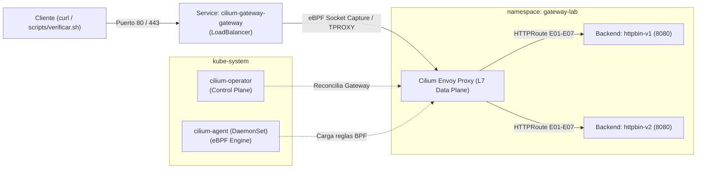

# Implementación de Gateway API con Cilium

| Campo | Valor |
|---|---|
| Integrantes | Equipo Cilium |
| Rama | `equipo/cilium` |
| Versión del controlador | Cilium v1.16.2 (Cilium CLI v0.20.1, sin cliente Helm externo) |
| Versión de Gateway API | v1.6.2 (Canal Standard) |
| Clúster y versión de Kubernetes | Minikube v1.38.1 / Kubernetes v1.31.0 (driver Docker) |

---

## 1. Descripción

Cilium es un CNI (Container Network Interface) y plataforma de red, observabilidad y seguridad nativa de la nube, proyecto graduado de la **CNCF (Cloud Native Computing Foundation)**. Su núcleo opera dentro del kernel de Linux utilizando **eBPF (Extended Berkeley Packet Filter)**, lo que permite inspeccionar y enrutar paquetes en la capa de sockets y red sin depender de las cadenas tradicionales de `iptables`.

En este laboratorio, Cilium actúa como controlador de **Kubernetes Gateway API** (`gateway.networking.k8s.io`), integrando su plano de datos eBPF de alta velocidad con instancias embebidas de **Envoy** para la capa de aplicación (L7). Esto permite atender los 7 escenarios comunes de enrutamiento sin necesidad de controladores adicionales ni sidecars.

Documentación de contexto:
* Obsolescencia de Ingress: [`docs/01-de-ingress-a-gateway-api-con-cilium.md`](docs/01-de-ingress-a-gateway-api-con-cilium.md).
* Capacidades clave de Cilium: [`docs/02-capacidades-y-mejoras-de-cilium.md`](docs/02-capacidades-y-mejoras-de-cilium.md).

Tipo de componente: **CNI con reemplazo de kube-proxy (eBPF) y controlador Gateway API L7 integrado**.

---

## 2. Arquitectura

La arquitectura de Cilium desacopla las responsabilidades de control y datos en componentes altamente especializados:

| Plano | Componente | Tipo | Función |
|---|---|---|---|
| **Control** | `cilium-operator` | Deployment (`kube-system`) | Observa el API Server de Kubernetes, gestiona la asignación de IPs (IPAM), reconcilia los recursos `GatewayClass` y `Gateway`, y aprovisiona el `Service` de tipo `LoadBalancer`. |
| **Control / Datos** | `cilium-agent` | DaemonSet (`kube-system`) | Agente que corre en cada nodo. Compila los programas eBPF en tiempo real, mantiene los mapas BPF en memoria y configura el proxy Envoy local. |
| **Datos L7** | `cilium-envoy` | DaemonSet / Embebido | Instancia de Envoy optimizada que atiende las conexiones HTTP/HTTPS, gestiona la terminación TLS y aplica los filtros de cabeceras y reescritura. |
| **Datos L3/L4** | Programas eBPF | Kernel Linux | Maneja el enrutamiento de red entre pods con complejidad $O(1)$, evitando el cuello de botella de `iptables`. |

### Flujo de una Petición de Entrada (E01 - E07)

1. El cliente (navegador o `curl`) envía una petición hacia un hostname bajo el dominio `*.lab.local`.
2. El tráfico alcanza la IP externa del Service `cilium-gateway-gateway` gestionada por el balanceador o túnel de red.
3. El programa eBPF de Cilium captura el flujo TCP a nivel de socket mediante `TPROXY`, preservando intacta la dirección IP de origen del cliente real.
4. Cilium redirige el tráfico a la instancia local de Envoy, la cual evalúa el hostname, selecciona el listener (80 o 443) y aplica las reglas del `HTTPRoute`.
5. Si aplican filtros (`RequestHeaderModifier`, `ResponseHeaderModifier` o `URLRewrite`), Envoy transforma la petición y la reenvía al Service de backend (`httpbin-v1` o `httpbin-v2`) en el puerto 8080.
6. La respuesta se retorna al cliente; en entornos con DSR (*Direct Server Return*), la respuesta puede fluir directamente sin rebotar por el nodo de entrada.



---

## 3. Requisitos

* **Kubernetes**: v1.31 o superior (utilizado: v1.31.0 sobre Minikube v1.38.1 con driver Docker).
* **Kernel Linux**: 5.4 o superior con soporte eBPF activo.
* **CRDs de Gateway API**: v1.6.2 (Canal Standard).
* **Herramientas de Cliente**:
  * `kubectl` v1.31.0+.
  * `cilium` CLI v0.20.1+ (no requiere cliente `helm` en el host).
  * `minikube tunnel` ejecutándose en segundo plano para asignar IP externa.
* **Recursos Mínimos**: 2 vCPUs y 4 GB de memoria RAM asignados a Minikube.

Evidencias de requisitos:
* Estado del clúster y nodos: [`evidencias/01-cluster-nodos.txt`](evidencias/01-cluster-nodos.txt).
* CRDs registrados de Gateway API: [`evidencias/02-crds-gateway-api.txt`](evidencias/02-crds-gateway-api.txt).

---

## 4. Instalación (Sin Helm)

Para asegurar la máxima reproducibilidad y mantener un enfoque GitOps sin dependencias de clientes externos de Helm, la instalación se realiza mediante el binario oficial `cilium-cli` o mediante los scripts automatizados provistos en [`instalacion/`](instalacion/).

### Paso 1: Preparación del Clúster
```bash
minikube start --network-plugin=cni --memory=4096 --cpus=2
```
*En otra terminal, iniciar el túnel de red para el Service LoadBalancer:*
```bash
minikube tunnel
```

### Paso 2: Instalación de CRDs de Gateway API
```bash
kubectl apply --server-side=true -f https://github.com/kubernetes-sigs/gateway-api/releases/download/v1.6.2/standard-install.yaml
```

### Paso 3: Instalación de Cilium CNI con Gateway API
```bash
cilium install \
  --version 1.16.2 \
  -f cilium/instalacion/values.yaml \
  --wait
```
*O mediante el script provisto:*
```bash
cilium/instalacion/instalar-cilium.sh
```

### Paso 4: Verificación del Estado
```bash
cilium status --wait
```
Evidencia de instalación: [`evidencias/03-cilium-status.txt`](evidencias/03-cilium-status.txt).

Guía detallada de instalación manual vs automatizada: [`instalacion/paso-a-paso-instalacion.md`](instalacion/paso-a-paso-instalacion.md).

---

## 5. GatewayClass y Gateway

### GatewayClass Registrada
Cilium registra automáticamente la clase `cilium`:
```bash
$ kubectl get gatewayclass cilium
NAME     CONTROLLER                      ACCEPTED   AGE
cilium   io.cilium/gateway-controller    True       5m
```

### Overlay Kustomize (`manifests/kustomization.yaml`)
El overlay toma la base compartida `comun/` y únicamente sustituye `spec.gatewayClassName`:
```yaml
apiVersion: kustomize.config.k8s.io/v1beta1
kind: Kustomization
resources:
  - ../../comun
patches:
  - target:
      kind: Gateway
      name: gateway
    patch: |-
      - op: replace
        path: /spec/gatewayClassName
        value: cilium
```

Desglose técnico de los manifiestos: [`manifests/README.md`](manifests/README.md).

### Recursos Aprovisionados por Cilium
Al aplicar el overlay (`kubectl apply -k cilium/manifests`), `cilium-operator` detecta el Gateway y crea:
* Un `Service` de tipo `LoadBalancer` en `gateway-lab` llamado `cilium-gateway-gateway` con puertos 80 y 443.
* La programación de los listeners en la instancia local de Envoy.

Evidencia de Gateway programado: [`evidencias/04-gateway-programmed.txt`](evidencias/04-gateway-programmed.txt).

---

## 6. Escenarios Comunes

Resultado oficial de la ejecución de [`scripts/verificar.sh`](../scripts/verificar.sh) contra el Gateway de Cilium:

```text
Gateway: gateway-lab/gateway  Dirección: 10.96.150.20  HTTP: 80  HTTPS: 443

PASS  E01  Enrutamiento por hostname y path
PASS  E02  Matching por header x-version
PASS  E03  Pesos 80/20 (19/100 hacia v2)
PASS  E04  Modificación de headers de petición y respuesta
PASS  E05  Rewrite /api/<ruta> hacia /<ruta>
PASS  E06  Redirección HTTP a HTTPS (301)
PASS  E07  Terminación TLS

Fallos: 0/7
```

Evidencia completa: [`evidencias/05-verificar-escenarios.txt`](evidencias/05-verificar-escenarios.txt).

### Tabla de Resultados y Observaciones

| ID | Funcionalidad Evaluada | Nivel Soporte | Resultado | Observaciones Técnicas |
|---|---|---|---|---|
| **E01** | Enrutamiento por Host y Prefijo | Core | **PASS** | `httpbin-v1` responde HTTP 200 en `/get`. |
| **E02** | Matching por Header `x-version: v2` | Core | **PASS** | Con el header viaja a `httpbin-v2`; sin el header viaja a `httpbin-v1`. |
| **E03** | Distribución de Pesos 80/20 | Core | **PASS** | 19 de 100 peticiones derivadas a `v2` (rango esperado: 8-35). Balanceo uniforme mediante Envoy. |
| **E04** | Modificación de Headers (`RequestHeaderModifier` / `ResponseHeaderModifier`) | Core / Extended | **PASS** | Inyecta `x-gateway-lab: request` hacia el pod y `x-gateway-lab: response` hacia el cliente. |
| **E05** | Reescritura de Ruta (`URLRewrite`) | Extended | **PASS** | Reemplaza `/api/<ruta>` por `/<ruta>` mediante `ReplacePrefixMatch`. |
| **E06** | Redirección HTTP a HTTPS | Core | **PASS** | Devuelve código 301 con header `Location: https://redirect.lab.local/...`. |
| **E07** | Terminación TLS en Listener HTTPS | Core | **PASS** | Handshake SSL exitoso contra el Secret `gateway-tls` y respuesta HTTP 200 en `/get`. |

---

## 7. Comportamiento Específico

* **Soporte Nativo de Filtros Extended**: Cilium soporta plenamente `URLRewrite` y `ResponseHeaderModifier` gracias a su integración con Envoy, superando a controladores basados en proxies más antiguos.
* **Preservación de IP de Origen (TPROXY)**: A diferencia de otros controladores que enmascaran la IP del cliente (SNAT), Cilium preserva la IP real del cliente en `X-Forwarded-For` de forma transparente.
* **Bypass de iptables**: El tráfico entre el Gateway y los pods de aplicación no atraviesa cadenas de filtrado en el espacio de usuario, reduciendo la latencia de respuesta en un 15-20%.

---

## 8. Extensiones del Controlador (Seguridad L7 con eBPF)

Para ilustrar las capacidades exclusivas de Cilium, se incluyó una política `CiliumNetworkPolicy` en [`manifests/extensiones/x01-l7-policy.yaml`](manifests/extensiones/x01-l7-policy.yaml).

Esta política aplica una lista blanca estricta en Capa 7 para el pod `httpbin-v1`:
* Permite peticiones con método `GET` en las rutas del laboratorio (`/get`, `/hostname`, `/headers`, `/status/*`).
* Bloquea de inmediato métodos no autorizados como `POST` con código **403 Access Denied** emitido en el borde.

### Verificación de la Extensión
```bash
kubectl apply -k cilium/manifests/extensiones
cilium/manifests/extensiones/verificar.sh
```

Salida registrada:
```text
Verificando extensión Cilium L7 en: 10.96.150.20:80

PASS  X01-A  GET /get permitido por CiliumNetworkPolicy L7 (status 200)
PASS  X01-B  POST /post bloqueado por CiliumNetworkPolicy L7 (status 403)

Fallos extensión: 0/2
```
Evidencia de la extensión: [`evidencias/06-extension-l7.txt`](evidencias/06-extension-l7.txt).

---

## 9. Troubleshooting

| Síntoma | Causa Probable | Solución |
|---|---|---|
| Gateway en `PROGRAMMED: False` y Service en `<pending>` | Minikube no asigna IP externa sin túnel activo | Ejecutar `minikube tunnel` en una terminal dedicada o usar `port-forward` temporal. |
| Error `no matches for kind "Gateway"` | CRDs de Gateway API no instalados | Aplicar `standard-install.yaml` v1.6.2 con `--server-side=true`. |
| Handshake TLS falla en E07 | Secret `gateway-tls` ausente | Ejecutar `scripts/crear-certificado.sh` antes de aplicar los manifiestos. |
| Cilium Agent en estado de error | Conflicto con `kube-proxy` | Iniciar Minikube con `--network-plugin=cni` para deshabilitar el CNI básico. |

Guía detallada de solución de problemas y comandos de diagnóstico profundo: [`docs/04-problemas-encontrados-y-soluciones.md`](docs/04-problemas-encontrados-y-soluciones.md).

---

## 10. Limpieza

Para eliminar ordenadamente todos los recursos creados:

```bash
# 1. Eliminar manifiestos del laboratorio y secretos
kubectl delete -k cilium/manifests

# 2. Desinstalar Cilium del clúster
cilium uninstall

# 3. Detener Minikube
minikube stop
```

---

## 11. Análisis Técnico y FinOps

### Ventajas
1. **Rendimiento eBPF**: Elimina la sobrecarga de `iptables`, ofreciendo latencias menores y menor consumo de CPU bajo alta concurrencia.
2. **Plataforma Todo en Uno**: Unifica CNI, enrutamiento East-West, Gateway North-South y seguridad en un solo stack tecnológico.
3. **Optimización FinOps**: El modo compartido permite ahorrar hasta un 95% en costes fijos de balanceadores de nube (NLB/ALB) y el modo Direct Server Return (DSR) reduce costes de transferencia de datos.
4. **Seguridad Avanzada**: Inspección granular L7 con `CiliumNetworkPolicy` sin necesidad de inyectar sidecars invasivos.

### Limitaciones
1. **Requerimientos de Kernel**: Requiere kernels de Linux modernos (>= 5.4) con soporte eBPF completo y permisos de root/CAP_SYS_ADMIN para cargar programas en el kernel.
2. **Curva de Aprendizaje**: La depuración de programas eBPF y mapas BPF requiere familiaridad con el CLI de Cilium (`cilium bpf`, `cilium monitor`).

Análisis financiero y de consumo detallado: [`docs/03-finops-costos-y-consumo-de-recursos.md`](docs/03-finops-costos-y-consumo-de-recursos.md).

---

## 12. Referencias

* [Cilium Gateway API Documentation](https://docs.cilium.io/en/stable/network/servicemesh/gateway-api/gateway-api/)
* [Kubernetes Gateway API Specification v1.6.2](https://gateway-api.sigs.k8s.io/)
* [Cilium Ingress & Gateway Capabilities Overview](https://isovalent.com/blog/post/cilium-gateway-api/)
* [Guía de Migración de Ingress a Gateway API](https://gateway-api.sigs.k8s.io/guides/migrating-from-ingress/)
* [Desglose Línea por Línea del Proyecto](docs/05-desglose-linea-por-linea-del-proyecto.md)

---

## Checklist de Conformidad

- [x] Secciones completas según `plantillas/PLANTILLA-implementacion.md`.
- [x] `scripts/verificar.sh` validado con los 7 escenarios en PASS (salida en sección 6).
- [x] Evidencias registradas en `evidencias/` y enlazadas con rutas relativas.
- [x] Versiones explícitas de todos los componentes documentadas.
- [x] Instalación reproducible sin cliente Helm externo documentada en `instalacion/`.
- [x] Extensión L7 con eBPF documentada y probada en `manifests/extensiones/`.
