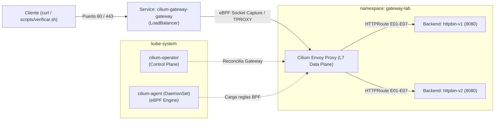

# Implementación de Gateway API con Cilium

| Campo | Valor |
|---|---|
| Integrantes | Equipo Cilium |
| Rama | `equipo/cilium` |
| Versión del controlador | Cilium v1.20.3 (Envoy v1.38.6), instalado con `cilium-cli` v0.20.1 |
| Versión de Gateway API | v1.6.2 (Canal Standard) |
| Clúster y versión de Kubernetes | Minikube v1.38.1 (driver kvm2, kernel 6.6.95) / Kubernetes v1.35.1, sin kube-proxy |

---

## 1. Descripción

Cilium es un CNI (Container Network Interface) y plataforma de red, observabilidad y seguridad nativa de la nube, proyecto graduado de la **CNCF (Cloud Native Computing Foundation)**. Su núcleo opera dentro del kernel de Linux utilizando **eBPF (Extended Berkeley Packet Filter)**, lo que permite inspeccionar y enrutar paquetes en la capa de sockets y red sin depender de las cadenas tradicionales de `iptables`.

En este laboratorio, Cilium actúa como controlador de **Kubernetes Gateway API** (`gateway.networking.k8s.io`), integrando su plano de datos eBPF de alta velocidad con instancias embebidas de **Envoy** para la capa de aplicación (L7). Esto permite atender los 7 escenarios comunes de enrutamiento sin necesidad de controladores adicionales ni sidecars.

Documentación de contexto:
* Obsolescencia de Ingress: [`docs/01-de-ingress-a-gateway-api-con-cilium.md`](docs/01-de-ingress-a-gateway-api-con-cilium.md).
* Capacidades clave de Cilium: [`docs/02-capacidades-y-mejoras-de-cilium.md`](docs/02-capacidades-y-mejoras-de-cilium.md).

Tipo de componente: **CNI con reemplazo de kube-proxy (eBPF) y controlador Gateway API L7 integrado**.

---

## 2. Arquitectura

La arquitectura de Cilium desacopla las responsabilidades de control y datos en componentes altamente especializados:

| Plano | Componente | Tipo | Función |
|---|---|---|---|
| **Control** | `cilium-operator` | Deployment (`kube-system`) | Observa el API Server de Kubernetes, gestiona la asignación de IPs (IPAM), reconcilia los recursos `GatewayClass` y `Gateway`, y aprovisiona el `Service` de tipo `LoadBalancer`. |
| **Control / Datos** | `cilium-agent` | DaemonSet (`kube-system`) | Agente que corre en cada nodo. Compila los programas eBPF en tiempo real, mantiene los mapas BPF en memoria y configura el proxy Envoy local. |
| **Datos L7** | `cilium-envoy` | DaemonSet / Embebido | Instancia de Envoy optimizada que atiende las conexiones HTTP/HTTPS, gestiona la terminación TLS y aplica los filtros de cabeceras y reescritura. |
| **Datos L3/L4** | Programas eBPF | Kernel Linux | Maneja el enrutamiento de red entre pods con complejidad $O(1)$, evitando el cuello de botella de `iptables`. |

### Flujo de una Petición de Entrada (E01 - E07)

1. El cliente (navegador o `curl`) envía una petición hacia un hostname bajo el dominio `*.lab.local`.
2. El tráfico alcanza la IP externa del Service `cilium-gateway-gateway` gestionada por el balanceador o túnel de red.
3. El programa eBPF de Cilium captura el flujo TCP a nivel de socket mediante `TPROXY`, preservando intacta la dirección IP de origen del cliente real.
4. Cilium redirige el tráfico a la instancia local de Envoy, la cual evalúa el hostname, selecciona el listener (80 o 443) y aplica las reglas del `HTTPRoute`.
5. Si aplican filtros (`RequestHeaderModifier`, `ResponseHeaderModifier` o `URLRewrite`), Envoy transforma la petición y la reenvía al Service de backend (`httpbin-v1` o `httpbin-v2`) en el puerto 8080.
6. La respuesta se retorna al cliente; en entornos con DSR (*Direct Server Return*), la respuesta puede fluir directamente sin rebotar por el nodo de entrada.



---

## 3. Requisitos

* **Kubernetes**: v1.31 o superior (utilizado: v1.35.1 sobre Minikube v1.38.1 con driver **kvm2**).
* **Driver de minikube**: `kvm2` (VM con kernel propio). Con el driver `docker` el Gateway queda `Programmed` pero las conexiones a Envoy expiran (sección 9).
* **Kernel Linux**: 5.4 o superior con soporte eBPF y módulos TPROXY (`xt_TPROXY`, `xt_socket`).
* **CRDs de Gateway API**: v1.6.2 (Canal Standard). Cilium 1.20 usa Gateway API v1.6 y necesita `TLSRoute` v1, incluido en ese canal.
* **Herramientas de cliente**:
  * `kubectl` v1.31.0+.
  * `cilium` CLI v0.20.1 (instalador propio de Cilium; no se usa el cliente `helm`).
* **Recursos mínimos**: 2 vCPUs y 4 GB de memoria RAM.

Evidencias de requisitos:
* Estado del clúster y nodos: [`evidencias/01-cluster-nodos.txt`](evidencias/01-cluster-nodos.txt).
* CRDs registrados de Gateway API: [`evidencias/02-crds-gateway-api.txt`](evidencias/02-crds-gateway-api.txt).

---

## 4. Instalación (Sin Helm)

La instalación usa `cilium-cli`, el instalador propio de Cilium (igual que `istioctl` en Istio), con la configuración versionada en [`instalacion/cilium.yaml`](instalacion/cilium.yaml). El orden importa: los CRDs de Gateway API deben existir antes de instalar Cilium, o el operador no registra la `GatewayClass`.

### Paso 1: Clúster sin CNI ni kube-proxy
```bash
minikube start --driver=kvm2 --cpus=2 --memory=4096 \
  --network-plugin=cni --cni=false \
  --extra-config=kubeadm.skip-phases=addon/kube-proxy
```
El nodo queda `NotReady` hasta que Cilium actúa como CNI. Sin `kube-proxy`, Cilium asume el balanceo de Services con eBPF (`kubeProxyReplacement: true`).

### Paso 2: CRDs de Gateway API
```bash
kubectl apply --server-side=true -f https://github.com/kubernetes-sigs/gateway-api/releases/download/v1.6.2/standard-install.yaml
```

### Paso 3: Cilium con Gateway API
```bash
cilium install --version 1.20.3 -f cilium/instalacion/cilium.yaml --wait
cilium status --wait
```

| Clave de `cilium.yaml` | Función |
|---|---|
| `kubeProxyReplacement: true` | Reemplazo de kube-proxy con eBPF; requisito del controlador de Gateway API. |
| `k8sServiceHost: auto` | Sin kube-proxy, lee la dirección del API Server del ConfigMap `cluster-info`. |
| `gatewayAPI.enabled: true` | Activa el controlador (`io.cilium/gateway-controller`) y la `GatewayClass` `cilium`. |
| `l2announcements.enabled`, `externalIPs.enabled` | Cilium anuncia por ARP las IPs de los Services `LoadBalancer`. |
| `k8sClientRateLimit` | Límite de peticiones al API Server; los anuncios L2 usan Leases. |

### Paso 4: IPs para Services LoadBalancer (LB IPAM)
```bash
kubectl apply -f cilium/instalacion/lb-ipam.yaml
```
[`instalacion/lb-ipam.yaml`](instalacion/lb-ipam.yaml) define un `CiliumLoadBalancerIPPool` (192.168.39.200-220, subred por defecto del driver kvm2; ajustar a la de `minikube ip`) y una `CiliumL2AnnouncementPolicy`. Así el Service del Gateway recibe una IP alcanzable desde el host sin `minikube tunnel` ni MetalLB, y `scripts/verificar.sh` funciona sin variables.

Evidencia de instalación: [`evidencias/03-cilium-status.txt`](evidencias/03-cilium-status.txt).

Script equivalente: [`instalacion/instalar-cilium.sh`](instalacion/instalar-cilium.sh). Guía paso a paso: [`instalacion/paso-a-paso-instalacion.md`](instalacion/paso-a-paso-instalacion.md).

---

## 5. GatewayClass y Gateway

### GatewayClass Registrada
Cilium registra automáticamente la clase `cilium`:
```bash
$ kubectl get gatewayclass cilium
NAME     CONTROLLER                      ACCEPTED   AGE
cilium   io.cilium/gateway-controller    True       5m
```

### Overlay Kustomize (`manifests/kustomization.yaml`)
El overlay toma la base compartida `comun/` y únicamente sustituye `spec.gatewayClassName`:
```yaml
apiVersion: kustomize.config.k8s.io/v1beta1
kind: Kustomization
resources:
  - ../../comun
patches:
  - target:
      kind: Gateway
      name: gateway
    patch: |-
      - op: replace
        path: /spec/gatewayClassName
        value: cilium
```

Desglose técnico de los manifiestos: [`manifests/README.md`](manifests/README.md).

### Recursos Aprovisionados por Cilium
Al aplicar el overlay (`kubectl apply -k cilium/manifests`), `cilium-operator` detecta el Gateway y crea:
* Un `Service` de tipo `LoadBalancer` en `gateway-lab` llamado `cilium-gateway-gateway` con puertos 80 y 443; LB IPAM le asigna `192.168.39.200`, que se publica en `status.addresses` del Gateway.
* Un `CiliumEnvoyConfig` con los listeners, rutas y clusters que el agente envía por xDS al DaemonSet `cilium-envoy`.

Evidencia de Gateway programado: [`evidencias/04-gateway-programmed.txt`](evidencias/04-gateway-programmed.txt).

---

## 6. Escenarios Comunes

Resultado oficial de la ejecución de [`scripts/verificar.sh`](../scripts/verificar.sh) contra el Gateway de Cilium:

```text
Gateway: gateway-lab/gateway  Dirección: 192.168.39.200  HTTP: 80  HTTPS: 443

PASS  E01  Enrutamiento por hostname y path
PASS  E02  Matching por header x-version
PASS  E03  Pesos 80/20 (22/100 hacia v2)
PASS  E04  Modificación de headers de petición y respuesta
PASS  E05  Rewrite /api/<ruta> hacia /<ruta>
PASS  E06  Redirección HTTP a HTTPS (301)
PASS  E07  Terminación TLS

Fallos: 0/7
```

Evidencia completa: [`evidencias/05-verificar-escenarios.txt`](evidencias/05-verificar-escenarios.txt).

### Tabla de Resultados y Observaciones

| ID | Funcionalidad Evaluada | Nivel Soporte | Resultado | Observaciones Técnicas |
|---|---|---|---|---|
| **E01** | Enrutamiento por Host y Prefijo | Core | **PASS** | `httpbin-v1` responde HTTP 200 en `/get`. |
| **E02** | Matching por Header `x-version: v2` | Core | **PASS** | Con el header viaja a `httpbin-v2`; sin el header viaja a `httpbin-v1`. |
| **E03** | Distribución de Pesos 80/20 | Core | **PASS** | 22 de 100 peticiones derivadas a `v2` (rango esperado: 8-35). |
| **E04** | Modificación de Headers (`RequestHeaderModifier` / `ResponseHeaderModifier`) | Core / Extended | **PASS** | Inyecta `x-gateway-lab: request` hacia el pod y `x-gateway-lab: response` hacia el cliente. |
| **E05** | Reescritura de Ruta (`URLRewrite`) | Extended | **PASS** | Reemplaza `/api/<ruta>` por `/<ruta>` mediante `ReplacePrefixMatch`. |
| **E06** | Redirección HTTP a HTTPS | Core | **PASS** | Devuelve código 301 con header `Location: https://redirect.lab.local/...`. |
| **E07** | Terminación TLS en Listener HTTPS | Core | **PASS** | Handshake SSL exitoso contra el Secret `gateway-tls` y respuesta HTTP 200 en `/get`. |

---

## 7. Comportamiento Específico

* **Envoy fuera del agente**: Cilium no despliega un proxy por Gateway; el DaemonSet `cilium-envoy` atiende todos los Gateways del nodo y recibe la configuración del agente por xDS (`CiliumEnvoyConfig`).
* **TPROXY hacia Envoy**: el Service del Gateway no tiene endpoints reales; eBPF marca el tráfico y una regla `TPROXY` lo entrega al listener de Envoy (`127.0.0.1:<puerto proxy>`). Envoy conecta con los pods desde la IP de identidad `reserved:ingress`.
* **IP de origen**: Envoy añade la IP real del cliente en `X-Forwarded-For` (en la prueba, `192.168.39.1`, el host).
* **Filtros Extended**: `URLRewrite` y `ResponseHeaderModifier` funcionan (E04, E05).

---

## 8. Extensiones del Controlador (Seguridad L7 con eBPF)

Para ilustrar las capacidades exclusivas de Cilium, se incluyó una política `CiliumNetworkPolicy` en [`manifests/extensiones/x01-l7-policy.yaml`](manifests/extensiones/x01-l7-policy.yaml).

Esta política aplica una lista blanca estricta en Capa 7 para el pod `httpbin-v1`:
* Permite peticiones con método `GET` en las rutas del laboratorio (`/get`, `/hostname`, `/headers`, `/status/*`).
* Bloquea de inmediato métodos no autorizados como `POST` con código **403 Access Denied** emitido en el borde.

### Verificación de la Extensión
```bash
kubectl apply -k cilium/manifests/extensiones
cilium/manifests/extensiones/verificar.sh
```

Salida registrada:
```text
Verificando extensión Cilium L7 en: 192.168.39.200:80

PASS  X01-A  GET /get permitido por CiliumNetworkPolicy L7 (status 200)
PASS  X01-B  POST /post bloqueado por CiliumNetworkPolicy L7 (status 403)

Fallos extensión: 0/2
```

Control: sin la `CiliumNetworkPolicy` aplicada, el mismo `POST /post` responde `200`.
Evidencia de la extensión: [`evidencias/06-extension-l7.txt`](evidencias/06-extension-l7.txt).

---

## 9. Troubleshooting

| Síntoma | Causa Probable | Solución |
|---|---|---|
| Service `cilium-gateway-gateway` en `<pending>` | Falta el pool de LB IPAM | Aplicar `instalacion/lb-ipam.yaml` con un rango de la subred de `minikube ip`. |
| Gateway `Programmed` pero todas las peticiones expiran (`000`); Envoy sin conexiones (`listener_downstream_cx_total` en 0) | Driver `docker` de minikube: el tráfico marcado por la regla `TPROXY` no llega al socket de Envoy (observado con kernel de host 7.1; con `bpf.tproxy=true` falla la vuelta desde los pods) | Usar `--driver=kvm2`. |
| Pods de Cilium en `ImagePullBackOff` en la VM kvm2 | La VM no tiene salida a internet (NAT de libvirt bloqueado por el firewall del host) | Corregir la red `default` de libvirt, o `docker pull` en el host y `minikube image load` (con `image.useDigest: false`). |
| `503` en las primeras peticiones | Pods de httpbin aún arrancando | Esperar `kubectl -n gateway-lab wait --for=condition=Available deployment --all`. |
| Error `no matches for kind "Gateway"` | CRDs de Gateway API no instalados | Aplicar `standard-install.yaml` v1.6.2 con `--server-side=true`. |
| Handshake TLS falla en E07 | Secret `gateway-tls` ausente | Ejecutar `scripts/crear-certificado.sh` antes de aplicar los manifiestos. |
| Error `namespaces "cilium-secrets" not found` | `secretsNamespace.create: false` en `cilium.yaml` sin namespace previo | Omitir `secretsNamespace` en `cilium.yaml`. |
| Error `cannot reuse a name that is still in use` | Intento fallido previo dejó release en estado roto | Ejecutar `cilium uninstall` antes de reintentar la instalación. |
| `cilium-operator` en CrashLoopBackOff (`no matches for TLSRoute v1alpha2`) | Cilium 1.16 usa Gateway API v1.1 (`TLSRoute` v1alpha2), que v1.6.2 ya no sirve | Usar Cilium 1.20.3 (Gateway API v1.6). No modificar el CRD compartido `tlsroutes`. |
| Cilium Agent en estado de error | CNI previo o `kube-proxy` en el clúster | Iniciar minikube con `--network-plugin=cni --cni=false --extra-config=kubeadm.skip-phases=addon/kube-proxy`. |
| Bloqueo de peticiones legítimas en extensión L7 | Política L7 desconoce la identidad `reserved:ingress` de Envoy | Utilizar `fromEntities: [ingress, cluster, host]` en `CiliumNetworkPolicy`. |

Guía detallada de solución de problemas con los 10 casos analizados a fondo: [`docs/04-problemas-encontrados-y-soluciones.md`](docs/04-problemas-encontrados-y-soluciones.md).

---

## 10. Limpieza

Para desmantelar y limpiar de forma automatizada todo el laboratorio:

```bash
cilium/instalacion/limpiar-todo.sh
```

O paso a paso manualmente:

```bash
# 1. Eliminar extensiones y manifiestos del laboratorio
kubectl delete -k cilium/manifests/extensiones --ignore-not-found=true
kubectl delete -k cilium/manifests --ignore-not-found=true

# 2. Pool de LB IPAM y Cilium
kubectl delete -f cilium/instalacion/lb-ipam.yaml --ignore-not-found=true
cilium uninstall

# 3. Clúster
minikube delete
```

---

## 11. Análisis Técnico y FinOps

### Ventajas
1. **Rendimiento eBPF**: el balanceo de Services se hace con eBPF sin kube-proxy (no se midió latencia en este laboratorio).
2. **Plataforma Todo en Uno**: Unifica CNI, enrutamiento East-West, Gateway North-South y seguridad en un solo stack tecnológico.
3. **Optimización FinOps**: El modo compartido permite ahorrar hasta un 95% en costes fijos de balanceadores de nube (NLB/ALB) y el modo Direct Server Return (DSR) reduce costes de transferencia de datos.
4. **Seguridad Avanzada**: Inspección granular L7 con `CiliumNetworkPolicy` sin necesidad de inyectar sidecars invasivos.

### Limitaciones
1. **Requerimientos de Kernel**: Requiere kernels de Linux modernos (>= 5.4) con soporte eBPF completo y permisos de root/CAP_SYS_ADMIN para cargar programas en el kernel.
2. **Curva de Aprendizaje**: La depuración de programas eBPF y mapas BPF requiere familiaridad con el CLI de Cilium (`cilium-dbg monitor`, `cilium-dbg envoy admin`).
3. **Dependencia del entorno**: el reenvío TPROXY hacia Envoy no funcionó con el driver `docker` de minikube; se requirió una VM (kvm2).

Análisis financiero y de consumo detallado: [`docs/03-finops-costos-y-consumo-de-recursos.md`](docs/03-finops-costos-y-consumo-de-recursos.md).

---

## 12. Referencias

* [Cilium Gateway API Documentation](https://docs.cilium.io/en/stable/network/servicemesh/gateway-api/gateway-api/)
* [Kubernetes Gateway API Specification v1.6.2](https://gateway-api.sigs.k8s.io/)
* [Cilium Ingress & Gateway Capabilities Overview](https://isovalent.com/blog/post/cilium-gateway-api/)
* [Guía de Migración de Ingress a Gateway API](https://gateway-api.sigs.k8s.io/guides/migrating-from-ingress/)
* [Desglose Línea por Línea del Proyecto](docs/05-desglose-linea-por-linea-del-proyecto.md)

---

## Checklist de Conformidad

- [x] Secciones completas según `plantillas/PLANTILLA-implementacion.md`.
- [x] `scripts/verificar.sh` validado con los 7 escenarios en PASS (salida en sección 6).
- [x] Evidencias registradas en `evidencias/` y enlazadas con rutas relativas.
- [x] Versiones explícitas de todos los componentes documentadas.
- [x] Instalación reproducible sin cliente Helm externo documentada en `instalacion/`.
- [x] Extensión L7 con eBPF documentada y probada en `manifests/extensiones/`.
