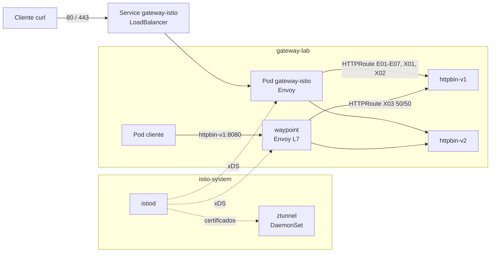

# Istio

| Campo | Valor |
|---|---|
| Integrantes | Juan Camilo Melo<br>Juan Felipe Garzon |
| Rama | `equipo/istio` |
| Versión del controlador | Istio 1.31.2 (`istioctl` 1.31.2, perfil `ambient`) |
| Versión de Gateway API | v1.6.2, canal Standard |
| Clúster y versión de Kubernetes | minikube v1.38.1 (driver docker), Kubernetes v1.35.1 |

## 1. Descripción

Istio es un service mesh de código abierto, proyecto graduado de la CNCF,
iniciado por Google, IBM y Lyft en 2017. Su plano de datos es Envoy (y ztunnel
en modo ambient).

Gateway API es la API recomendada por Istio para configurar tráfico, tanto de
entrada (north-south) como interno del mesh (east-west, iniciativa GAMMA). Istio
traduce `Gateway` y `HTTPRoute` a configuración de Envoy; las APIs propias
anteriores (`networking.istio.io` `Gateway` y `VirtualService`) siguen
soportadas, pero no se usan en este laboratorio.

Tipo de componente: service mesh con controlador de Gateway API integrado.

## 2. Arquitectura

| Plano | Componente | Tipo | Función |
|---|---|---|---|
| Control | `istiod` | Deployment, `istio-system` | Observa la API de Kubernetes (Gateway API, Services, políticas), genera configuración de Envoy y la distribuye por xDS. Emite los certificados mTLS (CA del mesh). Crea el Deployment y el Service de cada Gateway. |
| Datos | `gateway-istio` | Deployment + Service `LoadBalancer`, `gateway-lab` | Envoy creado por istiod a partir del `Gateway` `gateway`. Termina TLS y aplica las HTTPRoutes y las políticas del borde. |
| Datos | `ztunnel` | DaemonSet, `istio-system` | Proxy L4 por nodo del modo ambient. Cifra con mTLS (HBONE, puerto 15008) el tráfico de los pods inscritos en el mesh. |
| Datos | `istio-cni` | DaemonSet, `istio-system` | Configura la redirección del tráfico de los pods ambient hacia ztunnel. |
| Datos | `waypoint` | Deployment + Service, `gateway-lab` | Envoy L7 del mesh (X03). Es un `Gateway` con la clase `istio-waypoint`. |

Flujo de una petición de entrada (E01-E07):

1. El cliente envía `GET http://enrutamiento.lab.local/get` a la dirección del
   Service `gateway-istio` (IP del `LoadBalancer`, o IP del nodo y NodePort).
2. El Envoy del pod `gateway-istio` selecciona el listener (80 o 443) y el
   virtual host por el header `Host`.
3. Aplica la ruta generada desde la HTTPRoute: matches, filtros y pesos.
4. Reenvía al endpoint del pod `httpbin-v1` o `httpbin-v2`. Con el namespace en
   ambient (X03), la conexión viaja como mTLS HBONE y el ztunnel del nodo la
   entrega al pod.



Con X03 aplicado, las flechas hacia `httpbin-*` y desde `cliente` pasan por
ztunnel como mTLS. El gateway de entrada no atraviesa el waypoint.

## 3. Requisitos

| Componente | Versión | Verificación |
|---|---|---|
| Kubernetes | 1.32 a 1.37 (soportado por Istio 1.31); usado v1.35.1 | `kubectl version` |
| minikube | v1.38.1, driver docker | `minikube version` |
| kubectl | v1.36.2 (incluye kustomize v5.8.1) | `kubectl version --client` |
| istioctl | 1.31.2, igual a la versión de Istio | `istioctl version --remote=false` |
| CRDs de Gateway API | v1.6.2, Standard. Istio 1.31 se compila contra gateway-api v1.6.0. | `kubectl get crd \| grep gateway` |
| openssl, curl | cualquiera reciente | `scripts/crear-certificado.sh`, `scripts/verificar.sh` |

Recursos del clúster: 4 CPU y 6 GB de RAM para minikube. Memoria medida en
reposo con las extensiones aplicadas (`crictl stats`): istiod 56 Mi, istio-cni
27 Mi, ztunnel 5 Mi, gateway-istio 28 Mi, waypoint 26 Mi.

No se usa Helm: `istioctl` es el instalador propio de Istio.

Evidencia: [`evidencias/01-cluster.txt`](evidencias/01-cluster.txt),
[`evidencias/02-crds-gateway-api.txt`](evidencias/02-crds-gateway-api.txt).

## 4. Instalación

Todos los comandos se ejecutan desde la raíz del repositorio.

### 4.1 Clúster

```bash
minikube start -p istio-lab --driver=docker --cpus=4 --memory=6g --kubernetes-version=v1.35.1
kubectl config current-context        # istio-lab
kubectl get nodes                     # STATUS Ready
```

### 4.2 CRDs de Gateway API

Istio no instala los CRDs de Gateway API; deben existir antes que istiod.

```bash
kubectl apply --server-side=true -f https://github.com/kubernetes-sigs/gateway-api/releases/download/v1.6.2/standard-install.yaml
kubectl get crd | grep gateway.networking.k8s.io
```

### 4.3 istioctl

```bash
mkdir -p ~/.local/bin
curl -sL https://github.com/istio/istio/releases/download/1.31.2/istioctl-1.31.2-linux-amd64.tar.gz \
  | tar xz -C ~/.local/bin
istioctl version --remote=false       # client version: 1.31.2
```

### 4.4 Istio

Configuración en [`instalacion/istio.yaml`](instalacion/istio.yaml)
(`IstioOperator`):

```yaml
apiVersion: install.istio.io/v1alpha1
kind: IstioOperator
spec:
  profile: ambient
  tag: 1.31.2
  values:
    global:
      platform: minikube
```

| Campo | Efecto |
|---|---|
| `profile: ambient` | istiod + istio-cni + ztunnel. Sin ingress gateway propio: los Gateways se crean desde Gateway API. |
| `tag: 1.31.2` | Versión de las imágenes. |
| `global.platform: minikube` | Ajusta las rutas de CNI de minikube con driver docker; sin él, istio-cni no configura los pods ambient. |

`IstioOperator` no se crea en el clúster: `istioctl` lo lee, genera los
manifiestos y los aplica en orden (CRDs, RBAC, webhooks, istiod, DaemonSets) y
espera a que estén listos.

```bash
istioctl x precheck                                           # compatibilidad del clúster
istioctl manifest generate -f istio/instalacion/istio.yaml    # opcional: YAML que se aplicará
istioctl install -f istio/instalacion/istio.yaml -y
```

Verificación:

```bash
kubectl -n istio-system get pods      # istiod, istio-cni-node, ztunnel en Running
kubectl get gatewayclass              # istio, istio-remote, istio-waypoint en Accepted=True
istioctl version                      # client, control plane y data plane 1.31.2
```

```text
NAME             CONTROLLER                    ACCEPTED   AGE
istio            istio.io/gateway-controller   True       30s
istio-remote     istio.io/unmanaged-gateway    True       30s
istio-waypoint   istio.io/mesh-controller      True       30s
```

Evidencia: [`evidencias/03-istio-instalacion.txt`](evidencias/03-istio-instalacion.txt).

## 5. GatewayClass y Gateway

### 5.1 GatewayClass

istiod crea las GatewayClass al arrancar; no se declaran en el overlay.

| GatewayClass | Controlador | Uso |
|---|---|---|
| `istio` | `istio.io/gateway-controller` | Gateways de entrada. Usada por E01-E07, X01 y X02. |
| `istio-waypoint` | `istio.io/mesh-controller` | Waypoints del mesh ambient. Usada por X03. |
| `istio-remote` | `istio.io/unmanaged-gateway` | Gateways de otros clústeres (multi-cluster). No se usa. |

### 5.2 Overlay

[`manifests/kustomization.yaml`](manifests/kustomization.yaml) solo reemplaza
`gatewayClassName`; los listeners conservan los puertos 80 y 443 de `comun/`.

```yaml
apiVersion: kustomize.config.k8s.io/v1beta1
kind: Kustomization
resources:
  - ../../comun
patches:
  - target:
      kind: Gateway
      name: gateway
    patch: |-
      - op: replace
        path: /spec/gatewayClassName
        value: istio
```

```bash
scripts/crear-certificado.sh
kubectl apply -k istio/manifests
kubectl -n gateway-lab wait --for=condition=Available deploy --all --timeout=180s
```

### 5.3 Recursos aprovisionados

Por cada `Gateway` de clase `istio`, istiod crea en el mismo namespace un
Deployment y un Service llamados `<gateway>-<gatewayclass>`, con
`ownerReference` al Gateway (se borran con él):

```text
$ kubectl -n gateway-lab get deploy,svc,pods -l gateway.networking.k8s.io/gateway-name=gateway
NAME                            READY   UP-TO-DATE   AVAILABLE   AGE
deployment.apps/gateway-istio   1/1     1            1           13s

NAME                    TYPE           CLUSTER-IP      EXTERNAL-IP   PORT(S)                                      AGE
service/gateway-istio   LoadBalancer   10.108.55.141   <pending>     15021:32474/TCP,80:30777/TCP,443:30394/TCP   13s
```

| Puerto | Uso |
|---|---|
| 80, 443 | Listeners `http` y `https` del Gateway. |
| 15021 | Readiness de Envoy (`/healthz/ready`). |

Los puertos del Service se sincronizan con los listeners: agregar un listener al
Gateway agrega el puerto sin intervención.

### 5.4 Acceso al Gateway

El Gateway queda `Programmed=True` cuando el Service `LoadBalancer` recibe
dirección; Istio la publica en `status.addresses`. Mientras está en `<pending>`:

```text
Programmed=False AddressNotAssigned: Assigned to service(s) gateway-istio.gateway-lab.svc.cluster.local:443 and gateway-istio.gateway-lab.svc.cluster.local:80, but failed to assign to all requested addresses: address pending for hostname "gateway-istio.gateway-lab.svc.cluster.local"
```

El tráfico se procesa igual; solo falta la dirección externa.

Opción A, `minikube tunnel` (requiere `sudo` para exponer 80/443):

```bash
minikube tunnel -p istio-lab          # en otra terminal, mantener abierta
kubectl -n gateway-lab get gateway    # PROGRAMMED True, ADDRESS asignada
scripts/verificar.sh
```

Opción B, NodePort sin privilegios (usada en las evidencias):

```bash
export GATEWAY_ADDRESS="$(minikube -p istio-lab ip)"
export HTTP_PORT="$(kubectl -n gateway-lab get svc gateway-istio -o jsonpath='{.spec.ports[?(@.port==80)].nodePort}')"
export HTTPS_PORT="$(kubectl -n gateway-lab get svc gateway-istio -o jsonpath='{.spec.ports[?(@.port==443)].nodePort}')"
scripts/verificar.sh
```

Evidencia: [`evidencias/04-gateway.txt`](evidencias/04-gateway.txt).

## 6. Escenarios comunes

Ejecución en clúster limpio con la opción B de acceso
([`evidencias/05-verificar-escenarios.txt`](evidencias/05-verificar-escenarios.txt)):

```text
Gateway: gateway-lab/gateway  Dirección: 192.168.58.2  HTTP: 30777  HTTPS: 30394

PASS  E01  Enrutamiento por hostname y path
PASS  E02  Matching por header x-version
PASS  E03  Pesos 80/20 (21/100 hacia v2)
PASS  E04  Modificación de headers de petición y respuesta
PASS  E05  Rewrite /api/<ruta> hacia /<ruta>
PASS  E06  Redirección HTTP a HTTPS (301)
PASS  E07  Terminación TLS

Fallos: 0/7
```

| ID | Resultado | Observaciones |
|---|---|---|
| E01 | PASS | Virtual host `enrutamiento.lab.local:80` en la ruta `http.80` de Envoy. |
| E02 | PASS | Dos rutas de Envoy para `match.lab.local`: la de header `x-version: v2` se evalúa primero. |
| E03 | PASS | `weighted_clusters` de Envoy 80/20. Resultados de 15 a 23 sobre 100 en distintas ejecuciones. |
| E04 | PASS | `RequestHeaderModifier` (Core) y `ResponseHeaderModifier` (Extended) soportados. |
| E05 | PASS | `ReplacePrefixMatch: /` no deja doble barra: `/api/anything/x` llega como `/anything/x`; el original queda en `X-Envoy-Original-Path`. |
| E06 | PASS | `location: https://redirect.lab.local/get`, sin puerto explícito. |
| E07 | PASS | Listener 443 con match por SNI `*.lab.local` y certificado del Secret `gateway-tls`. |

La traducción a Envoy se inspecciona con `istioctl proxy-config`
([`evidencias/06-envoy-config.txt`](evidencias/06-envoy-config.txt)):

```bash
istioctl proxy-config listeners deploy/gateway-istio -n gateway-lab
istioctl proxy-config routes deploy/gateway-istio -n gateway-lab
```

## 7. Comportamiento específico

1. **Sin parche de puertos.** El pod del gateway se ejecuta como usuario no
   root (UID 1337) y abre 80/443 gracias al sysctl
   `net.ipv4.ip_unprivileged_port_start=0` que Istio agrega al pod. A diferencia
   de Traefik, el overlay no modifica los listeners.
2. **Un Deployment por Gateway.** Cada `Gateway` tiene su propio Envoy (modelo
   de despliegue automático). Un Gateway nuevo implica pods nuevos, con
   aislamiento entre Gateways a cambio de más consumo.
3. **`Programmed=False` sin dirección externa.** Istio exige dirección asignada
   al Service para marcar el Gateway como programado (sección 5.4).
4. **Headers añadidos por Envoy.** Las peticiones al backend incluyen
   `X-Envoy-Attempt-Count`, `X-Envoy-External-Address`, `X-Forwarded-For`,
   `X-Request-Id` y `X-Envoy-Peer-Metadata`; las respuestas, `server: istio-envoy`
   y `x-envoy-upstream-service-time`.
5. **Hostname sin ruta.** Una petición a un hostname sin HTTPRoute
   (`nadie.lab.local`) recibe 404 del Gateway.
6. **`istioctl analyze`**
   ([`evidencias/10-istioctl-analyze.txt`](evidencias/10-istioctl-analyze.txt)):
   - IST0171 `WaypointAccepted=False, TargetNotFound` en las AuthorizationPolicy
     con `targetRefs` al Gateway de entrada: la condición la escribe el
     controlador de waypoints, que no reconoce el gateway de entrada. Las
     políticas se aplican igual (X01 y X02 en PASS).
   - IST0175 `BLOCKED_CIDRS_IN_JWKS_URIS`: aplica a `jwksUri` remotos; X02 usa
     JWKS inline y no descarga nada.
   - IST0102 en `fuera-mesh`: el namespace queda fuera del mesh a propósito.

## 8. Extensiones del controlador

Recursos propios de Istio (`security.istio.io`) y funciones de mesh que Gateway
API no define. Manifiestos en [`manifests/extensiones/`](manifests/extensiones):

| ID | Archivo | Recursos | Prueba |
|---|---|---|---|
| X01 | [`x01-authz.yaml`](manifests/extensiones/x01-authz.yaml) | HTTPRoute `authz.lab.local`, `AuthorizationPolicy` DENY | `/anything/publico` 200, `/anything/privado` 403 |
| X02 | [`x02-jwt.yaml`](manifests/extensiones/x02-jwt.yaml) | HTTPRoute `jwt.lab.local`, `RequestAuthentication`, `AuthorizationPolicy` DENY | sin token 403, token inválido 401, token válido 200 y `x-jwt-sub` en el backend |
| X03 | [`x03-mesh.yaml`](manifests/extensiones/x03-mesh.yaml) | namespace en ambient, `PeerAuthentication` STRICT, Gateway `waypoint`, HTTPRoute GAMMA, pods `cliente` | 50/50 desde el mesh; cliente fuera del mesh rechazado |

[`manifests/extensiones/kustomization.yaml`](manifests/extensiones/kustomization.yaml)
incluye `comun/` con el mismo patch de `gatewayClassName` (kustomize no permite
referenciar el directorio padre) y agrega dos patches:

| Patch | Recurso | Efecto |
|---|---|---|
| `istio.io/dataplane-mode: ambient` | Namespace `gateway-lab` | ztunnel captura el tráfico de todos sus pods. |
| `istio.io/use-waypoint: waypoint` | Service `httpbin-v1` | El tráfico interno hacia `httpbin-v1` pasa por el waypoint. |

```bash
kubectl apply -k istio/manifests/extensiones
kubectl -n gateway-lab wait --for=condition=Programmed gateway/waypoint --timeout=120s
kubectl wait --for=condition=Ready pod/cliente -n gateway-lab --timeout=120s
kubectl wait --for=condition=Ready pod/cliente -n fuera-mesh --timeout=120s
istio/manifests/extensiones/verificar.sh       # mismas variables que scripts/verificar.sh
```

```text
PASS  X01  AuthorizationPolicy: /anything/publico 200, /anything/privado 403
PASS  X02  JWT: sin token 403, token inválido 401, token válido 200
PASS  X02  JWT: claim sub enviado al backend en x-jwt-sub
PASS  X03  GAMMA vía waypoint: 50/50 hacia httpbin-v1 (45/100 hacia v2)
PASS  X03  mTLS STRICT: cliente del mesh 200, cliente fuera del mesh rechazado

Fallos: 0/5
```

Con las extensiones aplicadas, `scripts/verificar.sh` sigue en `Fallos: 0/7`
([`evidencias/09-verificar-escenarios-con-mesh.txt`](evidencias/09-verificar-escenarios-con-mesh.txt)).

### X01. AuthorizationPolicy en el Gateway

```yaml
apiVersion: security.istio.io/v1
kind: AuthorizationPolicy
metadata:
  name: x01-authz
  namespace: gateway-lab
spec:
  targetRefs:
    - kind: Gateway
      group: gateway.networking.k8s.io
      name: gateway
  action: DENY
  rules:
    - to:
        - operation:
            ports: ["80"]
            hosts: ["authz.lab.local", "authz.lab.local:*"]
            paths: ["/anything/privado*"]
```

- `targetRefs` asocia la política al Envoy del Gateway, no a pods por labels.
- Las políticas DENY se evalúan antes que las ALLOW. Sin ninguna ALLOW, todo lo
  no denegado pasa; una sola ALLOW convertiría el Gateway en denegación por
  defecto.
- `ports: ["80"]`: sin puerto, Istio advierte que una regla DENY con solo
  atributos HTTP bloquearía también tráfico TCP del alcance.
- `hosts` incluye la variante con puerto porque el header `Host` puede llevarlo.
- Respuesta: `403 RBAC: access denied`, generada por Envoy sin llegar al backend.

### X02. JWT en el Gateway

- `RequestAuthentication` valida los JWT presentes contra el JWKS del emisor
  `testing@secure.istio.io` (muestra pública de Istio 1.31.2, inline). Token mal
  formado o con firma inválida: `401` con `www-authenticate: Bearer ... invalid_token`.
- Una petición sin token no es inválida, solo anónima. La `AuthorizationPolicy`
  DENY con `notRequestPrincipals: ["*"]` en `jwt.lab.local` la rechaza con `403`.
- `outputClaimToHeaders` copia el claim `sub` al header `x-jwt-sub`.
- Istio elimina el header `Authorization` antes de reenviar
  (`forwardOriginalToken: false` por defecto).
- `verificar.sh` descarga el token público de muestra de Istio
  (`security/tools/jwt/samples/demo.jwt`, release 1.31.2, `exp` en 2118),
  firmado con la clave del JWKS de muestra. No se versiona porque los
  detectores de secretos (GitGuardian) lo reportan como JWT. Sin acceso a
  internet, se pasa con la variable `JWT_TOKEN`.

### X03. Mesh ambient, waypoint y GAMMA

- **Inscripción.** El label `istio.io/dataplane-mode=ambient` del namespace basta
  para que istio-cni redirija el tráfico de sus pods a ztunnel. Sin sidecars ni
  reinicios.
- **mTLS.** `PeerAuthentication` STRICT obliga a recibir solo HBONE (mTLS con
  identidad SPIFFE). El pod `cliente` de `fuera-mesh` envía texto plano y
  ztunnel corta la conexión (`curl: Recv failure: Connection reset by peer`,
  código 56).
- **Waypoint.** Gateway con `gatewayClassName: istio-waypoint` y listener HBONE
  15008; Istio crea el Deployment `waypoint`. Procesa L7 solo para los Services
  con `istio.io/use-waypoint: waypoint`.
- **GAMMA.** La HTTPRoute `x03-mesh` tiene como `parentRef` el Service
  `httpbin-v1` (no un Gateway): el tráfico interno a `httpbin-v1:8080` se reparte
  50/50 entre v1 y v2. Estado: `Accepted=True ResolvedRefs=True ResolvedWaypoints=True`.
- **Aislamiento del borde.** El gateway de entrada envía directo a los pods (sin
  `istio.io/ingress-use-waypoint`), por lo que E02 sigue enviando a v1 las
  peticiones sin header.

```text
$ istioctl ztunnel-config workloads
NAMESPACE    POD NAME                          ADDRESS      NODE      WAYPOINT PROTOCOL
fuera-mesh   cliente                           10.244.0.10  istio-lab None     TCP
gateway-lab  cliente                           10.244.0.11  istio-lab None     HBONE
gateway-lab  gateway-istio-64ffb4c6bf-w7rkb    10.244.0.8   istio-lab None     TCP
gateway-lab  httpbin-v1-74dbdcb9f6-h2zjn       10.244.0.6   istio-lab None     HBONE
gateway-lab  httpbin-v2-654c65584f-s8djq       10.244.0.7   istio-lab None     HBONE
gateway-lab  waypoint-85bfcf56c-v5fmv          10.244.0.9   istio-lab None     TCP

$ istioctl ztunnel-config services
NAMESPACE    SERVICE NAME                SERVICE VIP    WAYPOINT ENDPOINTS
gateway-lab  httpbin-v1                  10.109.230.145 waypoint 1/1
gateway-lab  httpbin-v2                  10.105.167.110 None     1/1
```

`gateway-istio` y `waypoint` figuran como TCP porque son Envoy de Istio: hablan
HBONE por sí mismos y ztunnel no los intercepta.

Evidencia: [`evidencias/07-extensiones.txt`](evidencias/07-extensiones.txt),
[`evidencias/08-verificar-extensiones.txt`](evidencias/08-verificar-extensiones.txt).

## 9. Troubleshooting

| Síntoma | Causa | Solución |
|---|---|---|
| Gateway `Programmed=False`, `AddressNotAssigned`; Service en `<pending>` | minikube no asigna IP a Services `LoadBalancer`. | `minikube tunnel -p istio-lab`, o acceso por NodePort (sección 5.4). |
| `minikube tunnel`: `requires privileged ports to be exposed: [80 443]` | Exponer puertos menores a 1024 en el host requiere root. | Introducir la contraseña de `sudo`, o usar la opción B. |
| `scripts/verificar.sh`: `sin dirección en status.addresses` | Igual que el primer caso. | Definir `GATEWAY_ADDRESS`, `HTTP_PORT` y `HTTPS_PORT`. |
| GatewayClass `istio` inexistente | CRDs de Gateway API no instalados, o istiod no listo. | `kubectl get crd \| grep gateway`; `kubectl -n istio-system get pods`; si los CRDs se instalaron después, `kubectl -n istio-system rollout restart deploy/istiod`. |
| Listener `https` con `ResolvedRefs=False` | Falta el Secret `gateway-tls`. | `scripts/crear-certificado.sh`. |
| Advertencia al aplicar una AuthorizationPolicy DENY: `will deny all traffic to TCP ports` | Regla con solo atributos HTTP sin `ports`. | Declarar `ports` en `to.operation`. |
| X03: el cliente del mesh no recibe respuestas de v2 | Service sin `istio.io/use-waypoint` o waypoint no programado. | `istioctl ztunnel-config services` debe mostrar `waypoint` en `httpbin-v1`; `kubectl -n gateway-lab get gateway waypoint`. |
| Pods de `gateway-lab` en TCP y no HBONE en `istioctl ztunnel-config workloads` | Namespace sin `istio.io/dataplane-mode=ambient`, o instalación sin `global.platform=minikube` (requerido por Istio para minikube con driver docker). | `kubectl get ns gateway-lab --show-labels`; reinstalar con `istio/instalacion/istio.yaml`. |

Comandos de diagnóstico:

```bash
kubectl -n gateway-lab describe gateway gateway
kubectl -n gateway-lab describe httproute <nombre>
istioctl analyze -A
istioctl proxy-config routes deploy/gateway-istio -n gateway-lab
kubectl -n gateway-lab logs deploy/gateway-istio
kubectl -n istio-system logs deploy/istiod
```

## 10. Limpieza

```bash
# Laboratorio: gateway-lab (incluye Secret TLS y gateway-istio), fuera-mesh y extensiones.
# Sin extensiones aplicadas: kubectl delete -k istio/manifests
kubectl delete -k istio/manifests/extensiones

# Istio: istiod, ztunnel, istio-cni, webhooks, RBAC y CRDs de Istio
istioctl uninstall --purge -y
kubectl delete namespace istio-system

# CRDs de Gateway API
kubectl delete -f https://github.com/kubernetes-sigs/gateway-api/releases/download/v1.6.2/standard-install.yaml

# Clúster
minikube delete -p istio-lab
```

Verificación (antes de borrar el clúster):

```bash
kubectl get ns                               # sin gateway-lab, fuera-mesh, istio-system
kubectl get crd | grep -E 'istio|gateway'    # sin resultados
```

## 11. Análisis

Ventajas:

- Soporte completo de los escenarios Core y Extended evaluados, sin ajustes de
  puertos ni configuración específica en el overlay.
- Gateway API es la API principal de Istio: la misma especificación configura
  la entrada (Gateway) y el tráfico interno del mesh (waypoint y GAMMA).
- Seguridad integrada: mTLS automático entre servicios, autorización y JWT
  declarativos, aplicables al Gateway mediante `targetRefs`.
- Un Envoy por Gateway: aislamiento entre Gateways y escalado independiente.
- Diagnóstico detallado: `istioctl analyze`, `proxy-config`, `ztunnel-config`.

Limitaciones:

- Mayor complejidad y consumo que un proxy único: control plane, DaemonSets y un
  Deployment por Gateway y por waypoint.
- Curva de aprendizaje: modos sidecar y ambient, APIs de seguridad propias,
  conceptos de Envoy para depurar.
- Mensajes de estado y del analizador poco precisos en casos válidos (IST0171).
- Para entrada HTTP sin mesh, gran parte de la instalación no se utiliza.

Conformidad: el informe oficial de Istio 1.31 contra Gateway API v1.6.0
(`conformance/reports/v1.6/istio-istio/1.31.0-default-report.yaml`) da
`success` en los perfiles GATEWAY-HTTP, GATEWAY-GRPC, GATEWAY-TCP, GATEWAY-TLS
y MESH-HTTP. En este laboratorio superó los 7 escenarios comunes y las 3
extensiones (12/12 pruebas).

Casos de uso adecuados: plataformas que necesitan mTLS, políticas de
autorización y gestión de tráfico entre servicios además del ingreso; equipos
que buscan una sola API para tráfico norte-sur y este-oeste. Para un único
punto de entrada HTTP sin requisitos de mesh, un controlador más ligero
(Traefik, Kong) resulta más simple.

## 12. Referencias

- Istio, Gateway API: <https://istio.io/latest/docs/tasks/traffic-management/ingress/gateway-api/>
- Istio, versiones soportadas: <https://istio.io/latest/docs/releases/supported-releases/>
- Istio, prerrequisitos de ambient por plataforma: <https://istio.io/latest/docs/ambient/install/platform-prerequisites/>
- Istio, waypoints: <https://istio.io/latest/docs/ambient/usage/waypoint/>
- Istio, AuthorizationPolicy: <https://istio.io/latest/docs/reference/config/security/authorization-policy/>
- Istio, RequestAuthentication: <https://istio.io/latest/docs/reference/config/security/request_authentication/>
- Istio, IstioOperator: <https://istio.io/latest/docs/reference/config/istio.operator.v1alpha1/>
- Gateway API, GAMMA: <https://gateway-api.sigs.k8s.io/docs/mesh/gamma/>
- Gateway API, implementaciones: <https://gateway-api.sigs.k8s.io/implementations/>
- Informe de conformidad de Istio 1.31: <https://github.com/kubernetes-sigs/gateway-api/blob/main/conformance/reports/v1.6/istio-istio/1.31.0-default-report.yaml>

## Checklist

- [x] Secciones completas o con motivo de omisión.
- [x] `scripts/verificar.sh` ejecutado desde un clúster limpio; salida incluida en la sección 6.
- [x] Evidencias en `evidencias/` referenciadas desde este README.
- [x] Versiones explícitas de todos los componentes.
