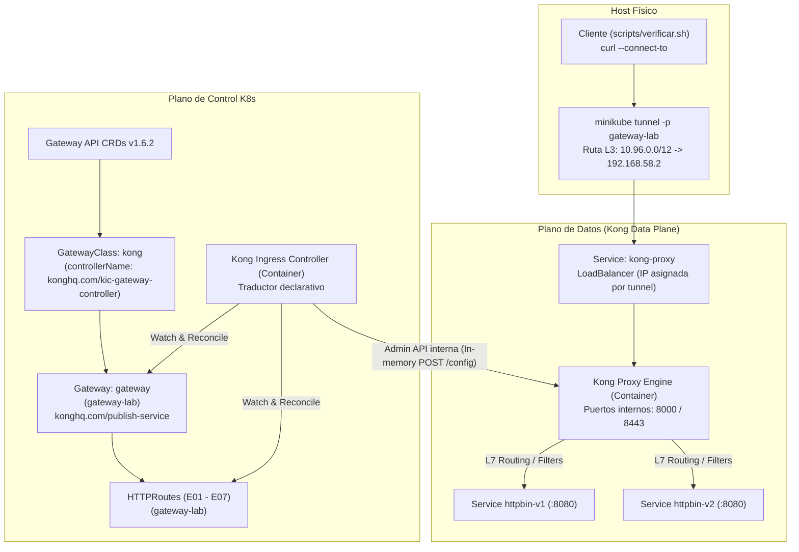

# Kong

| Campo | Valor |
| --- | --- |
| Integrantes | Santiago Gomez Robledo y Juan Jose Arias |
| Rama | `equipo/kong` |
| Versión del controlador | Kong Ingress Controller (KIC) `v3.5.0` |
| Versión del Data Plane | Kong Gateway `3.8.0` (DB-less) |
| Versión de Gateway API | `v1.6.2` (Canal Standard) |
| Clúster y versión de Kubernetes | Minikube `v1.39.0`, Kubernetes `v1.37.0` (containerd `2.3.4`) |

## 1. Descripción

Kong Gateway es un API Gateway nativo de la nube de alto rendimiento, modular y basado en OpenResty/Nginx. En entornos de Kubernetes, se opera mediante el **Kong Ingress Controller (KIC)**, el cual actúa como el plano de control encargado de traducir recursos declarativos de la API de Kubernetes (incluyendo la especificación estándar Gateway API) en configuraciones de enrutamiento y políticas de tráfico cargadas dinámicamente en la memoria del proxy Kong en modo **DB-less**.

## 2. Arquitectura

Kong opera bajo el modelo de **Gateway no gestionado (Unmanaged Gateway)**, con KIC y el proxy como contenedores del mismo pod (sin Gateway Discovery):

- **Plano de Control (KIC):** Monitorea los objetos `GatewayClass`, `Gateway` y `HTTPRoute` en el API Server y publica la configuración en memoria hacia la Admin API local del proxy Kong (`https://localhost:8444`).
- **Plano de Datos (Kong Proxy):** Recibe el tráfico en Capa 4/Capa 7 a través del Service `LoadBalancer` expuesto por `minikube tunnel`, ejecuta la terminación TLS, el balanceo de carga y aplica los filtros tipados hacia los pods de backend.



## 3. Requisitos

- **Minikube:** $\ge v1.31.0$ (probado en `v1.39.0` con K8s `v1.37.0` y driver `docker`; instalación manual verificada en un clúster limpio con `v1.38.1` y K8s `v1.35.1`).
- **Herramientas cliente:** `kubectl` ($\ge v1.31.0$), `curl`, `openssl`.
- **CRDs de Gateway API:** Canal Standard `v1.6.2` aplicado con `--server-side=true`.

## 4. Instalación

Despliegue declarativo sin Helm mediante manifiestos atómicos aplicados a mano en el perfil aislado `gateway-lab`:

```bash
# 1. En una terminal dedicada, mantener activo el túnel L3/L4:
minikube tunnel -p gateway-lab

# 2. Instalar CRDs oficiales de Gateway API v1.6.2 (Canal Standard):
kubectl apply --server-side=true -f https://github.com/kubernetes-sigs/gateway-api/releases/download/v1.6.2/standard-install.yaml

# 3. Desplegar Kong Gateway y KIC en modo DB-less aplicando los manifiestos:
kubectl apply -f kong/instalacion/

# 4. Verificar que el Pod de Kong esté operativo (2/2 Running) y el Service expuesto:
kubectl -n kong get pods -l app.kubernetes.io/name=kong
kubectl -n kong get svc kong-proxy
```

Los manifiestos en [`kong/instalacion/`](instalacion/) se estructuran de forma modular y con versiones fijas explícitas:
- `00-namespace.yaml`: Namespace dedicado `kong`.
- `01-crds.yaml`: Definiciones de recursos personalizados (CRDs) oficiales de Kong (`configuration.konghq.com`).
- `02-rbac.yaml`: ServiceAccount `kong`, ClusterRole/ClusterRoleBinding (lectura de Services, EndpointSlices, Secrets, CRDs de Kong y Gateway API; escritura de `status`) y Role/RoleBinding para la elección de líder (`leases`) y eventos.
- `03-service.yaml`: Service tipo `LoadBalancer` (`kong-proxy`) exponiendo los puertos 80 (HTTP) y 443 (HTTPS) hacia 8000/8443. El `targetPort` debe ser numérico: KIC lo compara con los puertos de `KONG_PROXY_LISTEN` para aceptar los listeners del Gateway.
- `04-deployment.yaml`: Deployment con el proxy Kong (`kong:3.8.0`) en modo DB-less y el controlador KIC (`kong/kubernetes-ingress-controller:3.5.0`) en el mismo pod. KIC envía la configuración a la Admin API del proxy por `https://localhost:8444`. Sin webhook de admisión.

Evidencia de la instalación en clúster limpio: [`evidencias/instalacion-manual.txt`](evidencias/instalacion-manual.txt).

## 5. GatewayClass y Gateway

### GatewayClass

Se registra la `GatewayClass` `kong` con la anotación `konghq.com/gatewayclass-unmanaged: "true"`, declarando a KIC como responsable de la conciliación:

```yaml
apiVersion: gateway.networking.k8s.io/v1
kind: GatewayClass
metadata:
  name: kong
  annotations:
    konghq.com/gatewayclass-unmanaged: "true"
spec:
  controllerName: konghq.com/kic-gateway-controller
```

### Overlay Kustomize (`manifests/kustomization.yaml`)

El overlay vincula el Gateway base a la clase `kong` e inyecta la anotación `konghq.com/publish-service` para enlazar el recurso con el Service LoadBalancer del proxy:

```yaml
apiVersion: kustomize.config.k8s.io/v1beta1
kind: Kustomization
resources:
  - ../../comun
  - gatewayclass.yaml
patches:
  - target:
      kind: Gateway
      name: gateway
    patch: |-
      - op: replace
        path: /spec/gatewayClassName
        value: kong
      - op: add
        path: /metadata/annotations
        value:
          konghq.com/publish-service: kong/kong-proxy
```

Al aplicarse, el Gateway en `gateway-lab` adopta la IP externa asignada por `minikube tunnel` (`10.108.244.77`), alcanzando `PROGRAMMED: True`.

## 6. Escenarios comunes

Resultado de la ejecución de [`scripts/verificar.sh`](../scripts/verificar.sh):

Ejecución con `kubectl -n kong port-forward svc/kong-proxy 18080:80 18443:443`:

```text
Gateway: gateway-lab/gateway  Dirección: 127.0.0.1  HTTP: 18080  HTTPS: 18443

PASS  E01  Enrutamiento por hostname y path
PASS  E02  Matching por header x-version
PASS  E03  Pesos 80/20 (21/100 hacia v2)
PASS  E04  Modificación de headers de petición y respuesta
PASS  E05  Rewrite /api/<ruta> hacia /<ruta>
FAIL  E06  Redirección HTTP a HTTPS (301): status=200
PASS  E07  Terminación TLS

Fallos: 1/7
```

| ID | Resultado | Observaciones |
| --- | --- | --- |
| E01 | PASS | Enrutamiento L7 por prefijo `/get` hacia `httpbin-v1` (HTTP 200 OK). |
| E02 | PASS | Coincidencia condicional de cabecera `x-version: v2` deriva a `httpbin-v2`; sin header deriva a `httpbin-v1`. |
| E03 | PASS | Distribución ponderada 80/20 comprobada en 100 peticiones consecutivas (≈20% hacia v2). |
| E04 | PASS | Filtros tipados `RequestHeaderModifier` y `ResponseHeaderModifier` inyectan `x-gateway-lab` correctamente. |
| E05 | PASS | Filtro `URLRewrite` (Extended) reescribe `/api/<ruta>` hacia `/<ruta>` de forma transparente. |
| E06 | FAIL | La petición HTTP a `redirect.lab.local` la atiende la ruta de E07 (200), porque KIC no separa rutas por listener. La ruta de E06 tampoco cumpliría: emite `Location: /` fijo (análisis en sección 7). |
| E07 | PASS | Terminación TLS en puerto 443 con certificado Secret `gateway-tls` (*.lab.local) y paso en claro hacia el backend. |

## 7. Comportamiento específico

### Fallo del escenario E06

Gateway API exige que `RequestRedirect` con `scheme: https` preserve host y ruta:
`GET http://redirect.lab.local/get` → `301` con `Location: https://redirect.lab.local/get`.

Rutas que KIC genera en Kong (Admin API, [`evidencias/e06-rutas-kong.txt`](evidencias/e06-rutas-kong.txt)):

```text
ROUTE  httproute.gateway-lab.e07-tls.0.0       hosts=[tls.lab.local, redirect.lab.local]  protocols=[http, https]  paths=[~/$, /]
ROUTE  httproute.gateway-lab.e06-redirect.0.0  hosts=[redirect.lab.local]                 protocols=[http, https]  paths=[~/$, /]
PLUGIN request-termination   (e06-redirect)  status_code=301
PLUGIN response-transformer  (e06-redirect)  add.headers=[Location:/]
```

1. **Sin aislamiento por listener.** `e06-redirect` usa `sectionName: http` y `e07-tls` usa `sectionName: https`, pero KIC crea ambas rutas con `protocols: [http, https]`, el mismo host y el mismo path. Kong elige una de ellas para la petición HTTP; en la ejecución anterior respondió la ruta de E07, con `200` desde el backend.
2. **Traducción incompleta del filtro.** Aunque la ruta de E06 atendiera la petición, KIC traduce `RequestRedirect` a `request-termination` (301) más `response-transformer` con la cabecera fija `Location: /`, sin esquema `https` ni host. El cliente sería redirigido a `/` en HTTP.

Una ejecución previa del equipo registró `status=426` (`https_redirect_status_code` de Kong, que se aplica cuando una ruta solo admite `https`). Con la instalación de `instalacion/` las rutas admiten ambos protocolos y el 426 no se reproduce; el fallo de fondo es el mismo.

#### Alternativa Nativa en Kong

En despliegues de producción sobre Kong Gateway, la redirección forzada a HTTPS se delega al motor nativo del proxy en lugar del filtro de ruta, especificando el código 301 de forma explícita mediante anotaciones:

```yaml
metadata:
  annotations:
    konghq.com/protocols: "https"
    konghq.com/https-redirect-status-code: "301"
```

## 8. Extensiones del controlador

Kong sobresale por la aplicación de políticas de Capa 7 mediante `KongPlugin`. Para demostrar la interoperabilidad con Gateway API sin recurrir a anotaciones propietarias en la ruta, se implementó una política de limitación de tasa (**Rate Limiting**) asociada a un `HTTPRoute` mediante el filtro tipado `ExtensionRef` en [`manifests/extension-ratelimit.yaml`](manifests/extension-ratelimit.yaml):

```yaml
apiVersion: configuration.konghq.com/v1
kind: KongPlugin
metadata:
  name: rate-limit-test
  namespace: gateway-lab
config:
  minute: 5
  policy: local
plugin: rate-limiting
---
apiVersion: gateway.networking.k8s.io/v1
kind: HTTPRoute
metadata:
  name: e08-extension-ratelimit
  namespace: gateway-lab
spec:
  parentRefs:
    - name: gateway
      sectionName: http
  hostnames:
    - ratelimit.lab.local
  rules:
    - matches:
        - path:
            type: PathPrefix
            value: /
      filters:
        - type: ExtensionRef
          extensionRef:
            group: configuration.konghq.com
            kind: KongPlugin
            name: rate-limit-test
      backendRefs:
        - name: httpbin-v1
          port: 8080
```

### Verificación de la Extensión

Al enviar 6 peticiones consecutivas dentro del minuto:

```text
HTTP/1.1 200 OK
HTTP/1.1 200 OK
HTTP/1.1 200 OK
HTTP/1.1 200 OK
HTTP/1.1 200 OK
HTTP/1.1 429 Too Many Requests
```

La sexta petición es bloqueada en el borde con código `429 Too Many Requests` directamente por el proxy Kong antes de alcanzar el backend.

## 9. Troubleshooting

| Síntoma | Causa Raíz | Solución |
| --- | --- | --- |
| `K8S_DOWNGRADE_UNSUPPORTED` al iniciar Minikube | Intento de iniciar Minikube forzando una versión inferior sobre un almacén `etcd` existente. | Iniciar Minikube con un perfil dedicado (`-p gateway-lab`) sin degradar la versión del cluster existente. |
| `Gateway sin dirección en status.addresses` | En Minikube, los servicios `LoadBalancer` quedan en `<pending>` si no hay un túnel de red activo en el host. | Ejecutar `minikube tunnel -p gateway-lab` en una terminal dedicada con privilegios de root. |
| Error `value must be null` en entidad `certificate` | Kong Gateway $\ge 3.9$ aplica validaciones estrictas de esquema que rechazan campos omitidos en la traducción de secretos TLS de KIC. | Fijar la versión exacta de Kong en `kong:3.8.0` y KIC en `3.5.0` en `kong/instalacion/04-deployment.yaml`. |
| Listeners con `UnsupportedProtocol: no Kong listen with the requested protocol is configured` | El Service `kong-proxy` usa `targetPort` con nombre (`proxy`); KIC necesita el número para emparejarlo con `KONG_PROXY_LISTEN`. | Usar `targetPort: 8000` y `8443` en `03-service.yaml` y reiniciar el Deployment `kong`. |
| `Gateway` en estado `Programmed: False` | Ausencia de enlace entre el objeto Gateway y el Service físico del proxy en modo no gestionado. | Inyectar la anotación `konghq.com/publish-service: kong/kong-proxy` mediante el parche de Kustomize. |

## 10. Limpieza

Para purgar todos los recursos desplegados:

```bash
# Eliminar la aplicación, el Gateway y los escenarios:
kubectl delete -k kong/manifests

# Purgar Kong Gateway, KIC, RBAC, Services y CRDs aplicados por manifiestos:
kubectl delete -f kong/instalacion/
```

## 11. Análisis

- **Ventajas:**
  - Desacoplamiento total del plano de control en memoria (DB-less), lo que elimina la necesidad de bases de datos relacionales en Kubernetes.
  - Integración nativa del estándar `ExtensionRef`, permitiendo aprovechar el ecosistema de más de 100 plugins de Kong (seguridad, autenticación, transformaciones) dentro de la especificación estándar de Kubernetes.
  - Soporte robusto de funcionalidades Extended como `URLRewrite` en Capa 7.
- **Limitaciones:**
  - El modo no gestionado (`gatewayclass-unmanaged`) requiere aprovisionar el plano de datos y el controlador mediante manifiestos declarativos manuales y asociarlo al Gateway mediante anotaciones de servicio de publicación.
  - KIC no aísla rutas por listener (`sectionName`): rutas con el mismo host en los listeners HTTP y HTTPS se crean con `protocols: [http, https]` y compiten entre sí. Además, `RequestRedirect` se traduce con `Location: /` fijo, por lo que la redirección a HTTPS requiere anotaciones nativas de Kong (`konghq.com/protocols`).
- **Nivel de Conformidad:** Alto cumplimiento en Core (E01, E02, E03, E04, E07) y Extended (E05).
- **Casos de Uso Adecuados:** Entornos empresariales que demandan gestión centralizada de APIs, control de cuotas/rate limiting por consumidor y políticas de seguridad avanzadas en el borde.

## 12. Referencias

- [Documentación oficial de Kong Ingress Controller](https://docs.konghq.com/kubernetes-ingress-controller/latest/)
- [Especificación de Kubernetes Gateway API v1.6.2](https://gateway-api.sigs.k8s.io/)
- [Kong Gateway API Guides](https://docs.konghq.com/kubernetes-ingress-controller/latest/guides/using-gateway-api/)
- [Issue #6557: RequestRedirect path preservation](https://github.com/Kong/kubernetes-ingress-controller/issues/6557)

---

## Checklist

- [x] Secciones completas o con motivo de omisión.
- [x] `scripts/verificar.sh` ejecutado desde un clúster limpio; salida incluida en la sección 6.
- [x] Evidencias en `evidencias/` referenciadas desde este README.
- [x] Versiones explícitas de todos los componentes.
